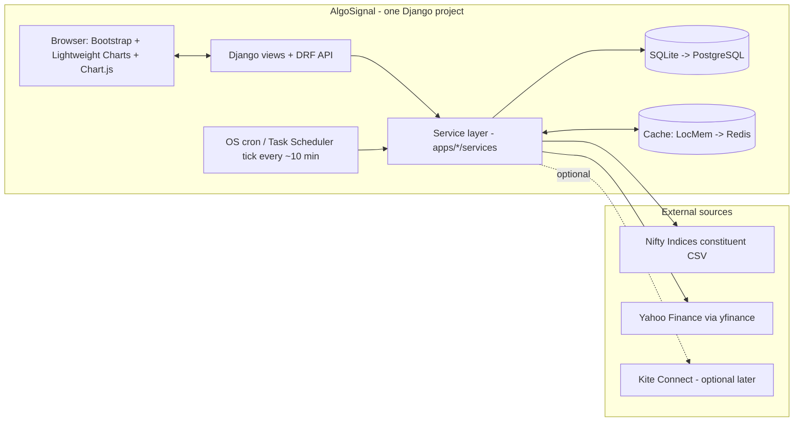
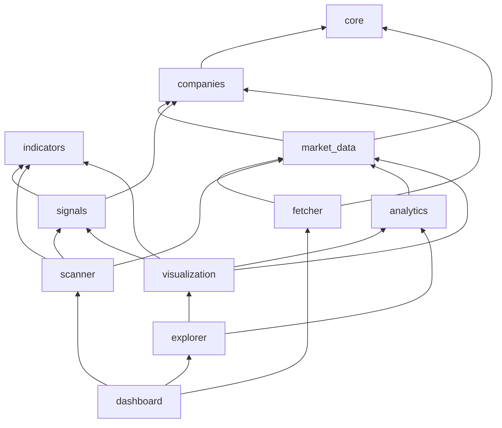
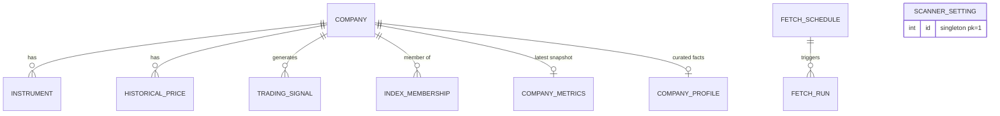
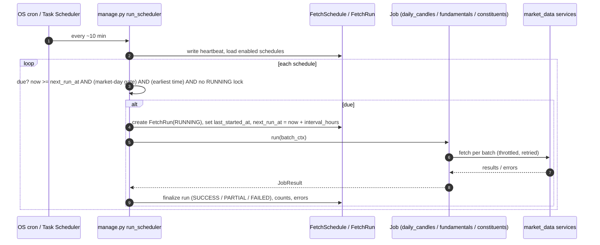
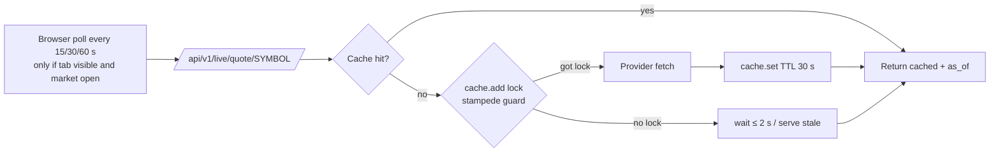
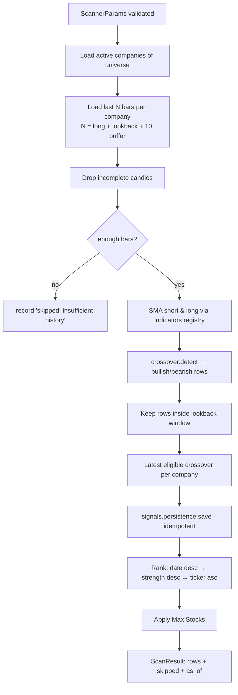
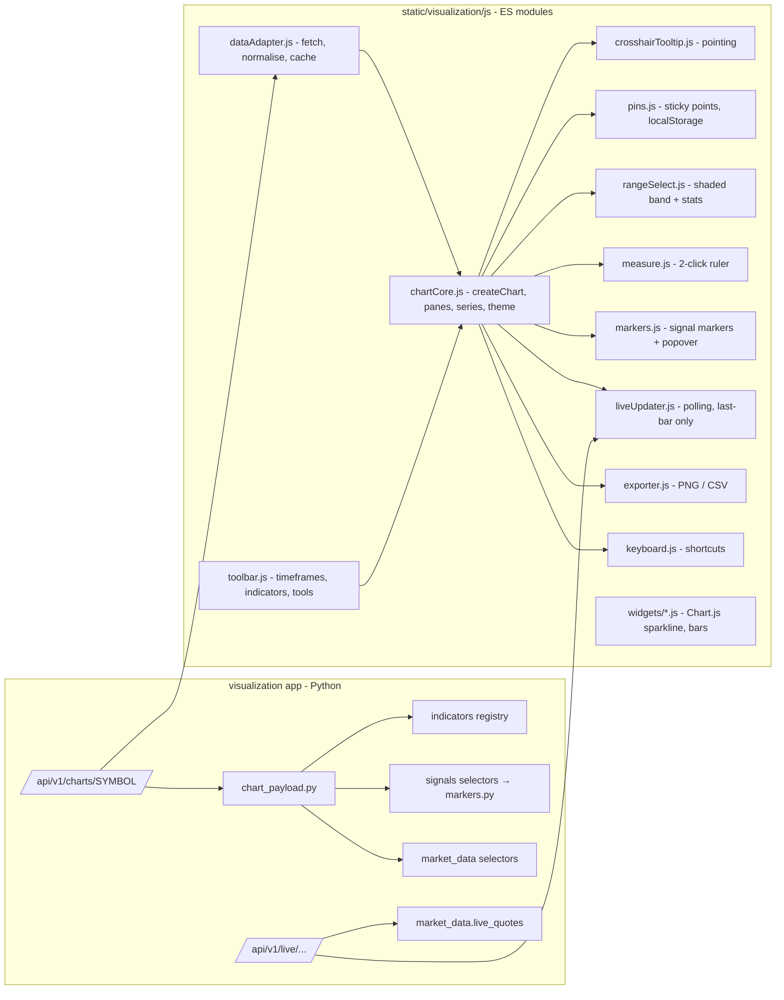

# AlgoSignal — Architecture (ARCHITECTURE.md)

| Item | Value |
|---|---|
| Document | Architecture v1.0 (Draft for approval) |
| Date | 23 Nov 2026 |
| Companion docs | `PRD.md` (what/screens/buttons) · `MASTER_PROMPT.md` (build prompt) |
| Audience | You + any AI coding assistant. Written so a beginner can follow, strict enough for production |

> **Terms are defined on first use** and again in the glossary (§23).

---

## 1. Architecture at a glance

**Style: modular monolith.** One Django project, many small apps — each app has *one job*.
**Analogy:** a restaurant kitchen. *Stations* (apps) each do one thing — prep (data fetching), grill (indicators), plating (charts). The *head chef* (scanner) coordinates stations but never cooks at someone else’s station. *Waiters* (views) only carry orders and plates; they never cook (no business logic in views).

### 1.1 Six principles
1. **Views are thin; services hold logic.** A *service* is a plain Python module/function that does business work and can be tested without HTTP.
2. **Pure calculations are separate from I/O.** Indicators/crossovers take a DataFrame and return a DataFrame — no DB, no network.
3. **Providers hide data sources.** Swap yfinance ↔ Kite ↔ another source without touching callers.
4. **Store only history; keep live data ephemeral.** Completed daily candles are persisted; live ticks are cached for seconds and discarded.
5. **Everything scheduled is idempotent** (safe to run twice) and **logged** (a row in the DB per run).
6. **Dependencies point downward only** (see §5). No circular imports.

### 1.2 System context


---

## 2. Technology stack

| Layer | Choice | Version policy | Why | Replaceable by |
|---|---|---|---|---|
| Language | Python 3.12+ | Pin minor in `pyproject.toml` | Modern typing, speed | — |
| Web framework | Django (**current LTS** at install time) | Pin exact in requirements; verify with `pip index versions django` | Batteries included, ORM, admin | — |
| API | Django REST Framework | Pin | Serializers, throttling, auth | Django Ninja |
| Database | SQLite (dev) → PostgreSQL (prod) | `DATABASE_URL` | Zero-setup dev; prod-grade later | — |
| Data analysis | Pandas, NumPy | Pin | Vectorised rolling math | Polars (later) |
| Market data | `yfinance` (default) | Pin; upgrade deliberately — it changes often and is rate-limited | Free, no sign-up | Kite Connect, other vendors |
| Frontend | Django templates, Bootstrap 5.3, vanilla ES modules | Vendored in `static/vendor/` | No Node build step for a beginner; no runtime CDN dependency | Vite/React later |
| Price charts | **TradingView Lightweight Charts v5** (Apache-2.0; v5 adds multi-pane + primitives; latest docs are 5.2) | Pin `5.x`; v5 API uses `chart.addSeries(CandlestickSeries, …)` | Fast canvas finance charts, zoom/pan/crosshair | ECharts |
| Widget charts | Chart.js 4 | Pin | Bars, sparklines, doughnuts | — |
| Config | `django-environ` (`.env`) | Pin | 12-factor config | — |
| Static files | WhiteNoise | Pin | Simple prod static serving | nginx/CDN |
| App server | gunicorn (prod) | Pin | Standard WSGI | uvicorn |
| Cache | Django cache: LocMem (dev) → Redis (prod) | Config switch | Live-quote caching | — |
| Scheduling | **OS cron / Task Scheduler → `run_scheduler`**; Celery + Redis only when §20 criteria are met | — | Zero extra infra | Celery Beat |
| Quality | pytest, pytest-django, factory_boy, freezegun, responses, coverage, ruff, pre-commit | Pin | Fast tests, one tool for lint+format | black + flake8 |

> **Version note:** all “Pin” rows mean *choose the latest stable at install time, then lock it* (`pip-compile` or `pip freeze`). Don’t copy version numbers from old tutorials.

---

## 3. Repository layout

```
algosignal/
├── manage.py
├── pyproject.toml                # ruff, pytest, coverage config
├── requirements/{base,dev,prod}.txt
├── .env.example                  # documented variables, NO secrets
├── .gitignore  .pre-commit-config.yaml  README.md
├── docs/
│   ├── PRD.md  ARCHITECTURE.md  MASTER_PROMPT.md
│   └── adr/                      # one short file per architecture decision
├── config/
│   ├── settings/{base,dev,prod,test}.py
│   ├── urls.py                   # page routes
│   ├── api_urls.py               # /api/v1/ aggregator
│   └── wsgi.py  asgi.py
├── apps/
│   ├── core/            # shared kernel
│   ├── companies/       # who is in the universe
│   ├── market_data/     # HOW to get prices & fundamentals; stores prices
│   ├── fetcher/         # WHEN/which batch: schedules, runs, locking
│   ├── indicators/      # pure maths (SMA, later EMA/RSI…)
│   ├── signals/         # crossover detection + TradingSignal storage
│   ├── scanner/         # orchestrates a scan; Signals page
│   ├── analytics/       # returns, top performers, market overview
│   ├── visualization/   # chart APIs + all chart JS/CSS
│   ├── explorer/        # company search + detail page composition
│   └── dashboard/       # dashboard + settings page composition
├── templates/           # base.html, partials/
├── static/{vendor,css,js}/
├── tests/fixtures/      # sample CSV, candles, yfinance info JSON
└── scripts/             # cron examples, backup script
```

### 3.1 Standard app skeleton
```
apps/<app>/
├── models.py          # data tables only (+ tiny model-level validation)
├── admin.py
├── services/          # business logic — the only place rules live
├── selectors.py       # read-only queries (ORM → plain objects/dicts)
├── api/{serializers,views,urls}.py
├── views.py  urls.py  forms.py      # thin HTML layer
├── management/commands/
├── templates/<app>/   static/<app>/{js,css}/
├── tests/
└── migrations/
```
**Services vs selectors:** a *service* **does** something (import, fetch, scan, save). A *selector* **asks** something (list companies, latest candle). Views call selectors to read and services to act.

---

## 4. App responsibility matrix

| App | One-line job | Owns (models) | Key services | Pages / API | Commands | Depends on | Must **not** |
|---|---|---|---|---|---|---|---|
| `core` | Shared kernel | `TimeStampedModel` (abstract) | `market_hours.py`, `money.py` (Decimal/INR formatting), `throttle.py`, `errors.py`, `pagination.py` | Base layout, Login, 403/404/500, `/health/` | — | — | Import any other app |
| `companies` | Universe of companies | `Company`, `IndexMembership`, `CompanyProfile` | `importer.py`, `column_mapper.py` | S2 Companies · `/api/v1/companies/` | `import_constituents` | `core` | Fetch prices; compute indicators |
| `market_data` | Know **how** to get & store market data | `Instrument`, `HistoricalPrice`, `CompanyMetrics` | `providers/{base,yfinance_provider,kite_client}.py`, `instrument_mapper.py`, `historical_data.py`, `fundamentals.py`, `completeness.py`, `live_quotes.py` | `/api/v1/prices/`, `/api/v1/live/` | `map_instruments`, `fetch_historical`, `fetch_fundamentals`, (`kite_login`) | `core`, `companies` | Decide *when* to run; compute indicators |
| `fetcher` | Know **when/which batch**: schedules, runs, locks | `FetchSchedule`, `FetchRun` | `scheduler.py`, `jobs/{daily_candles,fundamentals,constituents}.py`, `locking.py`, `retry.py` | S6 Market Data · `/api/v1/fetcher/` | `run_scheduler` | `core`, `companies`, `market_data` | Contain provider-specific code |
| `indicators` | Pure indicator maths | — (no tables) | `sma.py`, `registry.py` (later `ema.py`, `rsi.py`, `macd.py`, `bollinger.py`) | — | — | `pandas`/`numpy` only | Touch DB, network, Django |
| `signals` | Detect & store crossovers | `TradingSignal` | `crossover.py` (pure), `persistence.py` (idempotent save) | `/api/v1/signals/` | — | `core`, `companies`, `indicators` | Load prices itself |
| `scanner` | Orchestrate a scan; scanner settings | `ScannerSetting` | `scanner.py`, `params.py` (validation dataclass), `ranking.py` | S3 Signals · `/api/v1/scanner/` | `run_scan` | `core`, `companies`, `market_data`, `indicators`, `signals` | Contain SMA or crossover maths |
| `analytics` | Returns & market stats | — (computes from prices) | `performance.py`, `market_overview.py`, `sector_stats.py` | S4 Top Performers · `/api/v1/analytics/` | — | `core`, `companies`, `market_data` | Fetch from providers |
| `visualization` | Chart data shaping + **all chart front-end code** | — | `chart_payload.py`, `markers.py`, `timeframes.py` | S8 Chart Workspace · `/api/v1/charts/` | — | `core`, `companies`, `market_data`, `indicators`, `signals`, `analytics` | Own business rules; write to DB |
| `explorer` | Search + company detail composition | — | `search.py`, `company_view.py` | S5a/S5b · `/api/v1/search/` | — | all lower apps (read-only) | Duplicate logic from lower apps |
| `dashboard` | Dashboard + Settings composition | — | `summary.py` | S1, S7 · `/api/v1/dashboard/` | — | all lower apps | Own models |

### 4.1 `core`
Home of anything *every* app needs and *no* app owns: Indian-number/₹ formatting, `market_hours.py` (NSE session 09:15–15:30 IST, Mon–Fri, optional holiday JSON), a **throttle/limiter** helper, the error hierarchy, base templates, design-system CSS tokens, health endpoint, shared `TimeStampedModel` (`created_at`, `updated_at`, timezone-aware).

### 4.2 `companies`
- **Importer pipeline:** download CSV (with a descriptive `User-Agent`; retry) → hash (skip if unchanged) → `pandas.read_csv` → **column mapper** (lower-case, strip, alias map: `company name|name`, `symbol|nse symbol|ticker`, `industry|sector`, `isin code|isin`, `series`) → validate required columns → upsert → snapshot → summary log.
- **Match order:** ISIN → NSE code → create. (Handles ticker renames.)
- **Removed constituents:** set `IndexMembership.effective_to = today`, `Company.is_active=False` only if it belongs to no tracked index; never delete.
- **Source URLs** are configuration: `NIFTY_INDEX_CSV_URLS = {"NIFTY100": [primary, fallback]}`. The commonly used pattern is `…/ind_nifty100list.csv` hosted under niftyindices.com and NSE archives — **confirm the live URL in Phase 3** (sites occasionally move files) and keep it out of code.
- **Classification:** CSV `Industry` → `Company.sector` (authoritative, NSE’s broad classification); finer `industry` enriched from yfinance when available.

### 4.3 `market_data` (knows *how*)
- **Providers** implement one interface (§7). `yfinance_provider` converts `RELIANCE` → `RELIANCE.NS` (symbols such as `M&M`, `BAJAJ-AUTO` are handled and unit-tested).
- **`historical_data.py`**: `backfill(company, start, end)` and `update_latest(company)`; drops incomplete candles via `completeness.py`; writes with **upsert** (`bulk_create(update_conflicts=True, unique_fields=…)`).
- **`fundamentals.py`**: calls provider `get_company_info`, maps yfinance `info` keys → `CompanyMetrics` columns through a **mapper that normalises units** (e.g., fraction vs percent), upserts the single latest row.
- **`live_quotes.py`**: cache-first live quote/intraday (§9). No DB writes.
- **`completeness.py`**: `is_candle_complete(candle_date, now)` per PRD D5 (complete when date < today IST, or now ≥ 16:00 IST).

### 4.4 `fetcher` (knows *when*)
A job is a small function `run(batch_ctx) -> JobResult`. The scheduler loop decides *whether* to run it; the job calls `market_data` to *do* it. Provider-specific code never lives here. Details §8.

### 4.5 `indicators`
Pure functions registered by name:
```python
@register("sma")
def sma(df: pd.DataFrame, window: int, column: str = "close") -> pd.Series:
    return df[column].rolling(window=window, min_periods=window).mean()
```
Adding an indicator = (1) write the function, (2) register it, (3) add tests with a hand-calculated fixture. No caller changes.

### 4.6 `signals`
- `crossover.detect(df, short, long) -> DataFrame` (pure): returns rows `[candle_date, signal_type, short_sma, long_sma, close]`.
- `persistence.save(company, strategy, short, long, rows) -> SaveResult(inserted, skipped)` using `bulk_create(ignore_conflicts=True)` against the unique constraint.

### 4.7 `scanner`
`ScannerParams` is a **single validation dataclass** used by the form, the API serializer and the management command, so rules (short > 0, long > short, lookback > 0, max stocks > 0) exist once. `scanner.run(params, as_of=None) -> ScanResult` orchestrates §11.

### 4.8 `analytics`
Computes return windows from stored candles (§12). Provides market overview (advancers/decliners from the last two completed closes) and sector aggregates. Reads only.

### 4.9 `visualization` — *the graph app*
Everything a chart needs and nothing a business rule needs:
- **Backend:** `chart_payload.py` assembles *candles + indicator series + signal markers + meta* in one JSON; `timeframes.py` maps `1M…MAX` to date ranges; `markers.py` converts stored signals to marker objects.
- **Frontend (static):** the chart workspace modules (§13), Chart.js widgets, theming, export helpers, keyboard map.
- **Templates:** reusable partials (``, `sparkline.html`).
- **Rule:** if a requirement is “how a chart *looks or reacts*”, it belongs here; if it’s “what a number *means*”, it belongs in `analytics`/`indicators`/`signals`.

### 4.10 `explorer` and `dashboard`
Composition apps: they assemble pages from lower apps’ selectors/services and the `visualization` partials. They own no models and no business rules.

---

## 5. Dependency rules


**Enforced rules**
1. Imports go **down** only (an app never imports from an app above it). Add `import-linter` contracts in Phase 13.
2. Cross-app access goes through the other app’s **`services/`** or **`selectors.py`** — never by importing its models inside views.
3. `indicators` imports no Django. `signals.crossover` imports no Django.
4. Only `market_data` talks to external market sources; only `companies` talks to the constituent-list source.

---

## 6. Data architecture

### 6.1 Data tiers
| Tier | What | Where | Persisted? | Freshness | Example |
|---|---|---|---|---|---|
| **T1 Reference** | Companies, memberships, instruments, curated profiles | DB | Yes | On import / manual | Company list |
| **T2 History** | Completed daily candles | DB (`HistoricalPrice`) | **Yes** | Updated after market close | Close on 20-Nov |
| **T3 Snapshot** | Latest fundamentals per company | DB (`CompanyMetrics`, 1 row/company) | Yes (overwritten) | Every N hours (schedule) or on demand | P/E, market cap |
| **T4 Derived** | SMAs, returns, rankings | Computed on request (signals persisted) | Signals only | On demand | Top performers |
| **T5 Live** | Current quote / intraday bars | Cache (TTL 20–60 s) | **Never** | Seconds, may be delayed | LIVE price pill |

### 6.2 Entity-relationship diagram


### 6.3 Model specifications
Conventions: Django model names are **singular** (`Company`), all timestamps timezone-aware, money as `DecimalField`, constraints use `condition=` (Django ≥ 5.1 name; older `check=` is deprecated).

**`companies.Company`**
| Field | Type | Notes |
|---|---|---|
| id | AutoField PK | |
| company_name | Char(200) | indexed |
| nse_code | Char(20) | **unique**, indexed (symbol renames handled via ISIN) |
| bse_code | Char(10) | null/blank |
| isin | Char(12) | null, unique when not null |
| sector | Char(100) | null; from NSE CSV `Industry` |
| industry | Char(150) | null; enriched |
| description | Text | null |
| is_active | Bool | default True, indexed |
| created_at / updated_at | DateTime | auto |

**`companies.IndexMembership`** — `company` FK, `index_code` Char(30) (e.g. `NIFTY100`), `effective_from` Date, `effective_to` Date null, `source_url`, `source_sha256`, `imported_at`. Constraints: unique `(company, index_code, effective_from)`; **unique `(company, index_code)` where `effective_to IS NULL`** (one current membership).

**`companies.CompanyProfile`** (curated, never invented) — OneToOne `company`; `business_summary` Text; `products` Text; `services` Text; `website` URL; `source_name`; `source_url`; `verified_on` Date. All nullable; UI shows “Not available yet”.

**`market_data.Instrument`**
| Field | Type | Notes |
|---|---|---|
| company | FK | |
| exchange | Char choices `NSE`/`BSE` | |
| tradingsymbol | Char(30) | |
| provider_symbol | Char(40) | e.g. `RELIANCE.NS` |
| instrument_token | BigInteger | **null** (Kite only) |
| instrument_type | Char(20) | e.g. `EQ` |
| last_updated | DateTime | |
Unique `(exchange, tradingsymbol)`.

**`market_data.HistoricalPrice`**
| Field | Type | Notes |
|---|---|---|
| company | FK | |
| candle_date | Date | exchange date |
| open/high/low/close | Decimal(14,4) | **unadjusted** |
| adj_close | Decimal(14,4) | null; used for returns |
| volume | BigInteger | |
| source | Char(20) | `yfinance` |
| created_at / updated_at | DateTime | upsert refreshes `updated_at` |
Unique `(company, candle_date)`; index `(company, -candle_date)`. ~100 stocks × 252 days × 10 yrs ≈ 250k rows — tiny for SQLite and PostgreSQL.

**`market_data.CompanyMetrics`** — OneToOne `company`; columns for every field in PRD §8 (`current_price, previous_close, open_price, day_high, day_low, fifty_two_week_high, fifty_two_week_low, volume, average_volume, market_cap, trailing_pe, forward_pe, trailing_eps, book_value, price_to_book, dividend_yield, return_on_equity, return_on_assets, profit_margins, debt_to_equity, total_revenue, free_cashflow, net_income`), all **nullable**; plus `currency`, `source`, `fetched_at`.

**`signals.TradingSignal`**
| Field | Type | Notes |
|---|---|---|
| company | FK | |
| strategy | Char(30) | default `SMA_CROSS` |
| signal_type | Char choices `BULLISH`/`BEARISH` | |
| short_period / long_period | PositiveSmallInt | the parameters used |
| short_sma / long_sma | Decimal(14,4) | values on crossover date |
| close_price | Decimal(14,4) | |
| crossover_date | Date | |
| created_at | DateTime | |
Unique `(company, strategy, short_period, long_period, crossover_date)`; indexes `(-crossover_date)`, `(signal_type)`.

**`scanner.ScannerSetting`** (singleton, pk=1) — `short_period` (7), `long_period` (30), `lookback_days` (10), `max_stocks` (25), `auto_run_on_open` (False), `updated_at`. `CheckConstraint`s: `short_period > 0`, `long_period > short_period`, `lookback_days > 0`, `max_stocks > 0`.

**`fetcher.FetchSchedule`** — `job_type` choices (`DAILY_CANDLES`, `FUNDAMENTALS`, `CONSTITUENTS_SYNC`) **unique**; `enabled`; `interval_hours` (1–168); `only_market_days`; `earliest_time_ist` Time null; `universe_index`; `batch_size`; `throttle_seconds` Decimal; `last_started_at`, `last_finished_at`, `next_run_at`, `last_status`, `updated_at`.

**`fetcher.FetchRun`** — `job_type`, `schedule` FK null, `trigger` (`CRON`/`MANUAL`/`CLI`), `status` (`RUNNING`/`SUCCESS`/`PARTIAL`/`FAILED`), `started_at`, `finished_at`, `heartbeat_at`, `total_items`, `success_items`, `failed_items`, `rows_written`, `errors` JSON (`[{symbol, error_code, message}]`), `message`. Constituent imports also write a `FetchRun` (this is the “import error log”).

### 6.4 Deviations from your original spec (intentional)
| Your spec | This design | Reason |
|---|---|---|
| Model `Companies` (plural) | `Company` | Django convention; table `companies_company` |
| `ScannerSettings.short_sma/long_sma` (ints) | `short_period/long_period` | `TradingSignal.short_sma` is a *value*; avoid same name, different meaning |
| `instrument_token` required | nullable + `provider_symbol` | yfinance has no tokens |
| No adjusted price | `adj_close` added | Correct returns across splits/bonus |
| Duplicates by company + crossover date | + `strategy` + periods | Different SMA parameters are different signals |
| 5 models | + `IndexMembership`, `CompanyProfile`, `CompanyMetrics`, `FetchSchedule`, `FetchRun` | Supports snapshots, fundamentals cards, scheduler |

### 6.5 PostgreSQL-portability rules
No raw SQL, no SQLite-specific functions, no `AutoField` assumptions, `Decimal` not float, JSONField only for small logs, all queries via ORM, every migration tested on both engines in CI before the switch.

---

## 7. Data providers

### 7.1 Interface
```python
class MarketDataProvider(Protocol):
    name: str
    def get_daily_candles(self, symbols: list[str], start: date, end: date) -> dict[str, pd.DataFrame]: ...
    def get_company_info(self, symbol: str) -> dict: ...
    def get_live_quote(self, symbols: list[str]) -> dict[str, Quote]: ...
    def get_intraday(self, symbol: str, interval: str = "5m") -> pd.DataFrame: ...
    def health_check(self) -> ProviderHealth: ...
```
Error taxonomy (all subclass `ProviderError`): `ProviderRateLimited` (HTTP 429) · `ProviderNoData` (empty frame / delisted) · `ProviderTransient` (timeouts, 5xx) · `ProviderFatal` (auth/config). Callers handle each differently (§8.4).

### 7.2 yfinance provider (default)
- Symbols: `<NSE_CODE>.NS` (BSE: `.BO`). Benchmark index symbol is a setting (default `^NSEI`).
- Daily candles: batch `yf.download(symbols, start, end, interval="1d", auto_adjust=False, group_by="ticker", progress=False)` — gives raw OHLC **and** `Adj Close`.
- Fundamentals: `Ticker(symbol).info` (one slow HTTP call per ticker → needs throttling).
- Live: `Ticker.fast_info` / `history(period="1d", interval="1m")` → cache-first.
- **Reality check:** yfinance is an unofficial library that reads Yahoo’s endpoints. Public issue trackers show recurring `YFRateLimitError` / HTTP 429 reports, including for `.info`. Therefore **throttling, caching, back-off and a circuit breaker are mandatory**, not optional. Intraday NSE data may be delayed; always display the provider’s “as of” time.

### 7.3 Kite Connect adapter (optional, later)
`kite_client.py` implements the same interface. Auth flow: login URL → user authorises → `request_token` → exchange for `access_token` (expires daily) → stored **outside git** (env / secrets file / encrypted column). API key & secret **only** in environment; never in templates or JS. Historical data typically needs a paid developer subscription — check current terms before choosing it.

---

## 8. Fetcher & scheduler (the separate fetching app)

### 8.1 Why this design
Users want “fetch every *N hours*, and let me change N from the UI”. A fixed crontab can’t do that. Solution: **cron ticks often; the database decides whether a job is due.**



### 8.2 Jobs
| Job | What | Default interval | Gate | Notes |
|---|---|---|---|---|
| `DAILY_CANDLES` | Incremental update: from `last_candle+1` to today, **completed candles only** | 24 h | market days, earliest 16:15 IST | Batch of ~10 symbols per call |
| `FUNDAMENTALS` | Refresh `CompanyMetrics` for active companies | **12 h** (UI allows 1–168; warn under 6 h) | any day | ~2 s per ticker → ~4–5 min per 100 |
| `CONSTITUENTS_SYNC` | Re-import index CSV | 168 h | any day | Nifty indices rebalance semi-annually; weekly check is plenty |

### 8.3 Scheduling options (decision in ADR-05)
| Option | Use when | Verdict |
|---|---|---|
| **OS cron/Task Scheduler + `run_scheduler` tick** | Single machine, beginner, SQLite | ✅ **v1 default** |
| systemd timer | Linux server | ✅ same command |
| APScheduler inside Django | — | ❌ duplicates under multi-worker gunicorn |
| Celery Beat + Redis | Multiple workers, long jobs, progress UIs | ⏭ v1.1 when §20 criteria met |

Example crontab (Linux): `*/10 * * * * cd /srv/algosignal && /srv/algosignal/.venv/bin/python manage.py run_scheduler >> /var/log/algosignal/scheduler.log 2>&1`
Windows: Task Scheduler → trigger “repeat every 10 minutes” → action `python manage.py run_scheduler` (start in project folder).

### 8.4 Reliability policy
| Concern | Rule |
|---|---|
| **No overlap** | Before starting, `select_for_update` on the schedule row (PostgreSQL) / transactional check of a `RUNNING` `FetchRun` with `heartbeat_at` newer than 15 min (SQLite). Stale locks older than the timeout are marked `FAILED` and cleared. |
| **Throttle** | Fundamentals: `throttle_seconds` (default 2.0) + random jitter ±0.5 s between tickers; pause 10 s after each batch of 10. Candles: 3 s between batch calls. |
| **Retry** | `ProviderTransient`: up to 3 tries, delays 5 s → 15 s → 45 s. `ProviderRateLimited`: back-off 30 s → 60 s → 120 s. `ProviderNoData`: record, don’t retry. |
| **Circuit breaker** | 5 consecutive `ProviderRateLimited` → stop the run as `PARTIAL`, set a provider cool-down (30 min) in cache; UI shows “Provider cooling down”. |
| **Partial success** | A ticker failure is stored in `FetchRun.errors`; the batch continues. UI offers *Retry failed only*. |
| **Idempotent** | Upserts everywhere; re-running a window changes nothing unless the vendor corrected data. |
| **Heartbeat** | Every tick writes a cache/DB heartbeat; UI warns if older than 3 ticks. |
| **Logging** | `logger.info/warning/error` with `run_id`, `job`, `symbol`; never `print`. |

---

## 9. Live data pipeline (not stored)


- **Cache keys:** `live:quote:<SYMBOL>` (TTL 30 s), `live:intraday:<SYMBOL>:<interval>` (TTL 60 s), `provider:cooldown` (TTL 30 min).
- **Never persisted.** Live data touches no model. The chart’s last bar is updated **in the browser only**.
- **Market-hours logic** (`core.market_hours`): outside 09:15–15:30 IST (or on weekends/holidays) the endpoint returns the last completed close with `market_state="CLOSED"` and the UI stops polling.
- **Response envelope:** `{symbol, price, change, change_pct, as_of, market_state, source, delayed_hint}`. `as_of` is the **provider’s** timestamp, never `now()`.
- **LocMem caveat:** each gunicorn worker has its own cache; acceptable in v1, switch to Redis when scaling.

---

## 10. Indicator engine

- **Contract:** `fn(df, **params) -> Series | DataFrame`, input sorted ascending by `candle_date`, columns lower-case (`open, high, low, close, volume`).
- **SMA (Simple Moving Average):** average of the last *N* closes. `close.rolling(N, min_periods=N).mean()`; first *N−1* values are NaN by design.
- **Look-ahead safety rules:** only backward-looking windows; never `center=True`; never `shift(-k)`; never fill NaN backwards.
- **Registry:** `get_indicator("sma")(df, window=7)`. The chart payload builder and scanner both call the registry — so UI-selected “custom SMA 20” needs zero new backend code.
- **Planned (v1.1):** EMA, RSI, MACD, Bollinger, volume SMA — each with a fixture-based test.

---

## 11. Signals & scanner

### 11.1 Pipeline


### 11.2 Crossover algorithm (reference)
```python
def detect(df, short, long):
    s = sma(df, short).round(6); l = sma(df, long).round(6)
    diff = s - l
    prev = diff.shift(1)                     # backward-looking only
    valid = diff.notna() & prev.notna()      # both SMAs defined on both bars
    bullish = valid & (prev <= 0) & (diff > 0)
    bearish = valid & (prev >= 0) & (diff < 0)
    # build rows for True positions: candle_date, type, s, l, close
```
### 11.3 Edge cases
| Case | Behaviour |
|---|---|
| First day both SMAs exist | No signal (previous is NaN) |
| Averages equal for several days then separate | One signal when they separate |
| Averages remain on same side | No repeated signal |
| Fewer than `long + 1` bars | Company skipped and listed |
| Today’s incomplete candle present | Removed before calculation |
| Same-date ties in ranking | Strength desc, then ticker asc |
| Different SMA settings | Different signal rows (parameters are in the unique key) |
| Stock split inside window (unadjusted close) | Possible false signal → documented limitation; option to use `adj_close` for SMA is a v1.1 setting |

### 11.4 Lookback
Trading-session based: the crossover bar must be within the last `lookback_days` bars of that company’s completed series. Fetch window = `long + lookback + 10` bars so the first valid SMA never masquerades as a crossover.

---

## 12. Analytics

| Metric | Method |
|---|---|
| Return % | `((current − historical) / historical) × 100`; current = latest completed (adj) close; historical = last close on or before target date |
| Target dates | 1D: previous completed session · 1W: −7 days · 1M: −1 month · 3M · 6M · 1Y (`relativedelta`) |
| Basis | Adjusted close if present for **both** points, else unadjusted + `basis_warning=true` |
| Exclusions | History doesn’t reach target date, or latest candle > 5 days old → `excluded` with reason |
| Sector/industry filter | On `Company.sector` / `Company.industry` |
| Ranking | By return %, **never** market cap |
| Market overview | Advancers/decliners/unchanged from last two completed closes; sector average 1D return |
Implementation tip: load all closes for the universe in **one query**, pivot with Pandas, compute all six windows vectorised (no N+1 queries).

---

## 13. Visualization architecture

### 13.1 Component map


### 13.2 Chart workspace internals
| Layer | Responsibility |
|---|---|
| **Data adapter** | Calls chart API, converts numbers, de-duplicates, caches by `(symbol, tf)`, exposes `onUpdate` |
| **Chart core** | `createChart`, series via `chart.addSeries(CandlestickSeries | LineSeries | AreaSeries | HistogramSeries)`, **panes** for price/volume (RSI/MACD later), theme tokens from CSS variables, resize observer |
| **Plugins** | Each tool is an isolated module subscribing to the chart (`subscribeCrosshairMove`, `subscribeClick`, visible-range events) — add/remove without touching core |
| **Range select** | Preferred: a **series primitive** that draws a translucent band (time→x via `timeScale().timeToCoordinate`); fallback: absolutely-positioned overlay `<div>`; stats computed on the already-loaded bars (no server call) |
| **Markers** | v5 markers via the markers primitive (`createSeriesMarkers`); click handler hit-tests marker time |
| **Live updater** | Polls live endpoint; calls `series.update()` on the last bar only; flags bar as “incomplete”; stops on `visibilitychange` hidden or `market_state=CLOSED` |
| **State** | Plain JS store: `{symbol, tf, seriesType, indicators[], liveOn, tool, pins[], selection}`; persisted prefs (`tf`, `seriesType`, indicators, pins) in `localStorage` keyed by symbol |
| **Teardown** | `chart.remove()` and unsubscribe on navigation to avoid leaks |

### 13.3 Chart data contract
`GET /api/v1/charts/RELIANCE/?tf=1Y&sma=7,30&markers=1`
```json
{
  "symbol": "RELIANCE", "tf": "1Y", "basis": "unadjusted",
  "candles": [{"time": "2026-11-20", "open": 2930.1, "high": 2951.0, "low": 2922.4, "close": 2945.35, "volume": 6123456}],
  "indicators": {"sma_7": [{"time": "2026-11-20", "value": 2931.2}], "sma_30": [{"time": "2026-11-20", "value": 2888.7}]},
  "markers": [{"time": "2026-11-12", "type": "BULLISH", "price": 2901.5, "short_sma": 2890.1, "long_sma": 2889.9, "params": [7, 30]}],
  "meta": {"from": "2025-11-24", "to": "2026-11-20", "count": 248, "last_candle_date": "2026-11-20", "complete_only": true, "generated_at": "2026-11-23T10:15:00Z"}
}
```
Decimals are converted to floats **only here**. Limits: ≤ 5,000 bars per call; `before=<date>` param pages older data (lazy history).

### 13.4 Interaction → implementation
| PRD feature | Library hook / approach |
|---|---|
| Zoom / pan | Built-in handle-scroll / handle-scale; keyboard via `timeScale().scrollToPosition/ setVisibleLogicalRange` |
| Crosshair tooltip | `chart.subscribeCrosshairMove` → read series data at `param.time` → Info panel |
| Pin | `chart.subscribeClick` + `series.priceToCoordinate` for label placement |
| Select range | Mouse events on container + `timeScale().coordinateToTime`; band primitive; stats from loaded bars |
| Measure | Two clicks → floating label (Δ%, bars, calendar days) |
| Markers | Markers primitive, colours from tokens (`--as-bull`, `--as-bear`) + shape arrows |
| Fullscreen | `element.requestFullscreen()` |
| PNG export | `chart.takeScreenshot()` → canvas → download |
| CSV export | Visible logical range → Blob |
| Live | Polling + `series.update()` |
| Theme | `chart.applyOptions({layout…})` from CSS variables on `data-bs-theme` change |

### 13.5 Chart.js widget catalogue
Sparkline (no axes), advancers/decliners bar, returns horizontal bar, sector return strip. All read colours from CSS variables so dark mode works; all have a text alternative.

### 13.6 Performance budget
≤ 5,000 bars/series; resize via `ResizeObserver` (debounced); no per-frame DOM writes in crosshair handler (use `requestAnimationFrame`); destroy charts on tab switch; payloads gzip’d (`GZipMiddleware`).

### 13.7 Licensing
Keep Lightweight Charts’ attribution (TradingView link/logo) visible and ship its NOTICE per the library licence. Vendor the pinned build in `static/vendor/lightweight-charts/`.

---

## 14. API design

**Conventions:** base `/api/v1/` · JSON · session auth + CSRF · `IsAuthenticated` (writes/triggers `IsAdminUser`) · pagination `?page=&page_size=` · errors use one envelope:
```json
{"error": {"code": "VALIDATION_ERROR", "message": "Long SMA must be greater than Short SMA.", "fields": {"long_period": ["Must be greater than short_period."]}}}
```
HTTP: 200/201 success · 400 malformed · 401/403 auth · 404 · 409 job already running · 422 validation · 429 throttled · 502 provider failure · 503 provider cooling down.

| Method & path | Purpose | Auth | Throttle |
|---|---|---|---|
| `GET /companies/` · `GET /companies/{nse}/` | List/filter (q, sector, industry, signal, ordering) / detail | user | 120/min |
| `GET /companies/{nse}/metrics/` | Latest fundamentals snapshot | user | 120/min |
| `POST /companies/import/` | Run constituent import | staff | 6/hour |
| `GET /prices/{nse}/?from=&to=&limit=` | Stored candles | user | 120/min |
| `GET /charts/{nse}/?tf=&sma=&markers=&before=` | Chart payload (§13.3) | user | 120/min |
| `GET /live/quote/{nse}/` · `GET /live/quotes/?symbols=` (≤ 20) | Live quote(s) (cached, not stored) | user | 60/min |
| `GET /live/intraday/{nse}/?interval=5m` | Intraday bars for Live mode | user | 30/min |
| `POST /live/refresh-metrics/{nse}/` | Live-fetch fundamentals, update snapshot | user | 1/min per symbol |
| `POST /scanner/run/` | Run scan with body params | user | 10/min |
| `GET/PUT /scanner/settings/` | Defaults (PUT staff) | user/staff | 30/min |
| `GET /signals/?type=&from=&to=&company=` | Stored signals | user | 120/min |
| `GET /analytics/top-performers/?period=&sector=&industry=&limit=&order=&basis=` | Returns ranking | user | 60/min |
| `GET /analytics/market-overview/` · `GET /analytics/sectors/` | Dashboard stats | user | 60/min |
| `GET /dashboard/summary/` | KPI counts + freshness | user | 60/min |
| `GET /search/?q=` | Typeahead | user | 120/min |
| `GET /fetcher/schedules/` · `PUT /fetcher/schedules/{id}/` | View/edit schedules | user/staff | 30/min |
| `POST /fetcher/schedules/{id}/run-now/` | Start job now (409 if running) | staff | 6/hour |
| `POST /fetcher/backfill/` | Backfill history (scope, years/dates) | staff | 6/hour |
| `GET /fetcher/runs/?job=&status=` · `GET /fetcher/runs/{id}/` | History / detail (poll progress) | user | 120/min |
| `GET /market-data/coverage/` | Per-company first/last candle, count, gaps, stale | user | 30/min |
| `GET /health/` (non-API) | Liveness + DB + scheduler heartbeat | none | — |

---

## 15. Frontend architecture

- **Templates:** `base.html` (shell S0) → page templates extend it; partials for KPI card, company card, metric tile, freshness chip, empty/error states, toast container.
- **Static:** `static/css/algosignal.css` (tokens + component styles on top of Bootstrap 5.3 using `data-bs-theme`), `static/js/` ES modules (`api.js` fetch wrapper with CSRF + error envelope handling, `format.js` Indian numbers/₹/Cr, `toast.js`, `theme.js`, `table.js`).
- **No Node build** in v1: ES modules via `<script type="module">`; vendored libraries pinned; subresource-integrity not needed for self-hosted files.
- **State:** server renders the page shell; JS fetches JSON for widgets and hydrates. Each widget fails independently.
- **Mobile pattern:** `.scroll-snap-row` (flex, `overflow-x:auto`, `scroll-snap-type:x mandatory`, card min-width 260 px) for KPI and company cards.
- **Accessibility:** semantic landmarks, focus management after async results (move focus to results heading), `aria-live="polite"` for toasts/status, chart “view as table”.

---

## 16. Configuration & secrets

| Variable | Example | Notes |
|---|---|---|
| `DJANGO_SETTINGS_MODULE` | `config.settings.dev` | dev / prod / test |
| `SECRET_KEY` | (random 50+ chars) | required in prod |
| `DEBUG` | `False` | never True in prod |
| `ALLOWED_HOSTS` | `localhost,127.0.0.1` | |
| `DATABASE_URL` | `sqlite:///db.sqlite3` → `postgres://…` | |
| `TIME_ZONE` / `USE_TZ` | `Asia/Kolkata` / `True` | fixed in settings |
| `CACHE_URL` | `locmem://` → `redis://…` | |
| `INDEX_UNIVERSE` | `NIFTY100` | |
| `NIFTY_INDEX_CSV_URLS` | JSON map of lists | primary + fallback |
| `MARKET_DATA_PROVIDER` | `yfinance` | |
| `PROVIDER_THROTTLE_SECONDS` | `2.0` | |
| `KITE_API_KEY` / `KITE_API_SECRET` / `KITE_ACCESS_TOKEN` | unset by default | **never** logged, never sent to templates |
| `NSE_HOLIDAYS_FILE` | `data/nse_holidays.json` (optional) | |
| `LOG_LEVEL` | `INFO` | |
Rules: `.env` is git-ignored; `.env.example` documents every key; settings fail fast on missing required keys in prod.

---

## 17. Logging, errors, observability
- Python `logging` with JSON-ish formatter in prod; correlation IDs: `request_id` (middleware) and `run_id` (fetcher).
- Levels: INFO job start/finish, WARNING retries/skips, ERROR failures; **no secrets, no full provider payloads**.
- Rotating file handler (or stdout under systemd/docker). 
- User-facing errors are friendly; stack traces only in logs. Custom 404/500 templates show the request ID.
- `/health/` returns `{"status":"ok","db":"ok","scheduler_last_tick":"…","provider":"ok|cooling_down"}`.

---

## 18. Security
- Django auth required by default; staff for mutating/trigger endpoints; login throttling (e.g., `django-axes` or DRF throttle) after 5 failures.
- CSRF on all POST/PUT; `SESSION_COOKIE_SECURE`, `CSRF_COOKIE_SECURE`, HSTS, `SECURE_*` in prod.
- Secrets only from environment; pre-commit hook scans for keys; no secrets in front-end code.
- Input validation in `ScannerParams`/serializers; ORM only (no SQL injection); output escaping by Django templates; JSON via DRF.
- Outbound requests: timeouts always set; allow-list of source hosts; descriptive `User-Agent`.
- Dependency hygiene: pinned versions, `pip-audit` in CI.
- **Live trading disabled:** no order-placement code exists in v1; a future module must live in a separate app behind an explicit feature flag and review.

---

## 19. Testing architecture

| Level | Tooling | Scope |
|---|---|---|
| Unit | pytest, no DB where possible | indicators, crossover, returns, column mapper, completeness, formatters |
| Service/integration | pytest-django, factory_boy, `responses`/mocks, freezegun | importer, historical storage, fetcher gating/locking, scanner pipeline |
| API | DRF test client | contracts, validation, auth, throttling |
| UI smoke | Django test client + (optional) Playwright later | pages render, key buttons exist |
| Manual checklists | In PRD §7 | Chart interactions |

**No live network in unit tests.** Fixtures in `tests/fixtures/`: `ind_nifty100list_sample.csv`, `ind_nifty100list_renamed_columns.csv`, `candles_up_cross.csv`, `candles_down_cross.csv`, `candles_flat.csv`, `yf_info_reliance.json`.

| Required test (from your list) | Where |
|---|---|
| Company CSV import (+ renamed columns, bad rows, idempotency) | `companies/tests/test_importer.py` |
| Instrument token / provider-symbol mapping (`M&M`, `BAJAJ-AUTO`) | `market_data/tests/test_instrument_mapper.py` |
| Historical candle storage, no duplicates, incomplete-candle drop | `market_data/tests/test_historical_data.py` |
| SMA 7 / SMA 30 vs hand-calculated values | `indicators/tests/test_sma.py` |
| Bullish / bearish detection, equality edge, NaN guard | `signals/tests/test_crossover.py` |
| Duplicate signal prevention | `signals/tests/test_persistence.py` |
| Lookback filtering, ranking by date, Max Stocks | `scanner/tests/test_scanner.py` |
| Stock return calculations (all 6 windows, missing history) | `analytics/tests/test_performance.py` |
| Invalid scanner settings | `scanner/tests/test_params.py` |
| Scheduler: interval gating, no overlap, back-off, circuit breaker | `fetcher/tests/test_scheduler.py` |
| yfinance info → `CompanyMetrics` unit normalisation | `market_data/tests/test_fundamentals_mapper.py` |
| Chart payload shape & limits | `visualization/tests/test_chart_payload.py` |

CI (GitHub Actions or local `make check`): `ruff check` → `ruff format --check` → `pytest --cov` → `python manage.py makemigrations --check` → (later) run the suite on PostgreSQL.

---

## 20. Deployment & scaling path

| Stage | Setup |
|---|---|
| **Dev** | SQLite, LocMem cache, `runserver`, cron/Task Scheduler tick |
| **Single-server prod** | gunicorn + nginx (or Caddy), WhiteNoise static, **PostgreSQL**, systemd timer for `run_scheduler`, daily DB backup (`pg_dump` / SQLite `.backup`), logs to journald |
| **Scale-out (only when needed)** | Redis cache, Celery workers + Beat |

**Introduce Celery + Redis only when** any of these become true: jobs routinely exceed ~10 min and block other work · you need parallel workers · the UI needs live progress of long jobs beyond polling · you add alerts/emails that must be queued reliably. Until then the tick command is simpler and has fewer failure modes.

**SQLite → PostgreSQL checklist:** set `DATABASE_URL` · run migrations on an empty Postgres · load data with `dumpdata/loaddata` or a one-off copy script · rerun the full test suite on Postgres · verify constraints and indexes.

---

## 21. Architecture Decision Records (summary)

| ID | Decision | Alternatives | Reason |
|---|---|---|---|
| ADR-01 | Modular monolith with 11 apps | Single app; microservices | Clear ownership, tiny ops footprint |
| ADR-02 | Services + selectors; thin views | Fat views/models | Testability, your requirement |
| ADR-03 | yfinance default via provider interface | Kite first | Free/no sign-up; swap later |
| ADR-04 | Store completed candles only; live is cache-only | Store ticks | Prevents incomplete-candle signals; your rule |
| ADR-05 | Cron tick + DB-driven schedules | APScheduler, Celery | Editable “every N hours”, no extra infra |
| ADR-06 | Lightweight Charts (price) + Chart.js (widgets) | ECharts only | Best finance interactions + simple widgets |
| ADR-07 | Vendored JS, no Node build | npm/Vite | Beginner-friendly, no runtime CDN |
| ADR-08 | Lookback in trading sessions | Calendar days | Robust to holidays |
| ADR-09 | One scanner row per company | All crossovers | “Max Stocks” semantics |
| ADR-10 | Unique key includes strategy + periods | Company + date only | Different parameters ≠ duplicates |
| ADR-11 | Returns use adjusted close when available | Raw only | Splits/bonus correctness |
| ADR-12 | Singleton `ScannerSetting` + `ScannerParams` dataclass | Many settings rows | One validation source |

---

## 22. Risks & limitations (technical)
1. **Provider fragility** (rate limits, schema changes) → abstraction + throttling + health page + tests with recorded fixtures.
2. **Delayed/revised data** → show “as of”; upserts accept vendor corrections.
3. **Corporate actions** → adjusted close for returns; documented SMA caveat.
4. **Survivorship bias** (current constituents only) → documented; `IndexMembership` snapshots help from now on.
5. **Holiday calendar** → optional JSON; otherwise skip when no new candle.
6. **SQLite concurrency** (single writer) → short transactions; PostgreSQL before multi-process writes.
7. **Signals are lagging indicators** → disclaimer; backtesting planned v2.

---

## 23. Glossary
| Term | Meaning |
|---|---|
| **OHLCV** | Open, High, Low, Close prices and Volume for a time bar |
| **Candle** | One OHLCV bar (here: one trading day) |
| **Completed candle** | A daily bar after the market closed and data settled (≥ 16:00 IST) |
| **SMA** | Simple Moving Average: mean of the last *N* closes |
| **Bullish / Bearish crossover** | Short SMA crosses **above** / **below** the long SMA |
| **Lookback** | How many recent trading sessions a crossover may be to appear in results |
| **Adjusted close** | Close price corrected for splits/bonus/dividends so history is comparable |
| **Look-ahead bias** | Accidentally using future data when computing a past signal |
| **Idempotent** | Safe to run repeatedly with the same result |
| **Upsert** | Insert, or update if the row already exists |
| **Rate limit (HTTP 429)** | The data server telling you to slow down |
| **Circuit breaker** | Stop calling a failing service for a while instead of hammering it |
| **Service / Selector** | Python function that *does* something / *reads* something |
| **ADR** | Architecture Decision Record — short note explaining why a design choice was made |
| **Nifty 100** | NSE index of the top 100 companies by market capitalisation (Nifty 50 + Nifty Next 50) |
| **IST** | Indian Standard Time (UTC+05:30) |
