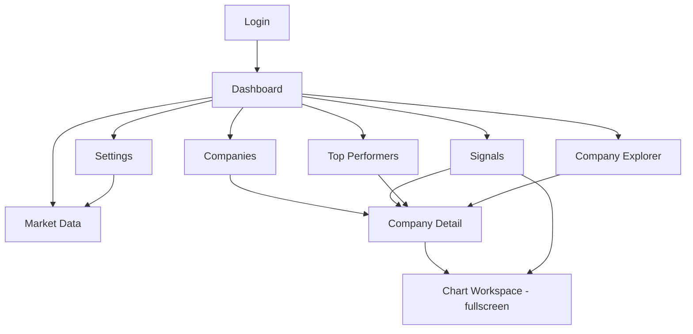

# AlgoSignal — Product Requirements Document (PRD.md)

| Item | Value |
|---|---|
| Product | **AlgoSignal** — Nifty stock research & signal-scanning platform |
| Document | PRD v1.0 (Draft for approval) |
| Date | 23 Nov 2026 |
| Owner | You (Django developer, product owner) |
| Companion docs | `ARCHITECTURE.md` (how it is built, which Django app owns what) · `MASTER_PROMPT.md` (the prompt that drives the build, phase by phase) |

> **How to read this PRD.** A *PRD* (Product Requirements Document) says **what** the product does and **how it looks and behaves** — every screen, button, chart and rule. `ARCHITECTURE.md` says **how** it is built. If the two ever disagree, fix the PRD first, then the architecture.

---

## 1. Product overview

### 1.1 Vision
AlgoSignal is a personal, research-grade web platform that scans **Nifty 100** stocks for **SMA crossover signals** (short-term vs long-term trend changes), ranks top performers, explains each company, and shows everything on fast, interactive charts. It is built so that **paper trading** and **automation** can be added later without rewriting the foundation.

### 1.2 Problem it solves
| Pain today | What AlgoSignal does |
|---|---|
| Manually opening 100 charts to spot trend changes | One-click scanner ranks all crossovers by recency |
| Data scattered across websites | One company page: profile, fundamentals, chart, signals |
| Unreliable ad-hoc scripts | Scheduled, logged, retry-safe data fetching with a visible health page |
| Fear of look-ahead bias / duplicate signals | Rules enforced in code and tests (completed candles only, idempotent signals) |

### 1.3 Goals
| ID | Goal | Measure of success |
|---|---|---|
| G1 | Reliable daily data for the whole universe | ≥ 98 % of active companies have the latest completed candle by 17:00 IST on trading days |
| G2 | Correct, reproducible signals | Hand-calculated test fixtures match 100 %; zero duplicate signals |
| G3 | Fast scanning | Generate Signals on 100 stocks < 3 s (from stored data) |
| G4 | Rich, smooth charts | Zoom/pan/crosshair/selection feel instant for ≥ 1,300 daily bars |
| G5 | Transparent data quality | Every number shows its source and “as of” time |
| G6 | Beginner-friendly build | Every phase has run + verify instructions and passing tests |

### 1.4 Non-goals (v1.0)
- ❌ **No live order execution**, broker order placement or auto-trading.
- ❌ No investment advice, buy/sell recommendations, price targets.
- ❌ No tick-by-tick real-time streaming (we poll; data may be delayed).
- ❌ No multi-user accounts/roles beyond Django’s built-in admin user.
- ❌ No backtesting engine (planned v2).

### 1.5 Personas
| Persona | Description | Top needs |
|---|---|---|
| **P1 – The Builder (you)** | Python/Django developer, learning algorithmic trading and production practices | Clear code, tests, run commands, safe defaults |
| **P2 – The Analyst (future)** | Someone who only reads dashboards | Fast scan, clean charts, trustworthy numbers |

### 1.6 Mandatory disclaimer (shown in app footer, Signals page and About)
> **Signals are research indicators, not guaranteed profitable trading recommendations.** AlgoSignal is not a SEBI-registered investment adviser or research analyst. Data comes from third-party free sources, may be delayed, incomplete or adjusted differently from official exchange data. Past performance does not indicate future results. Do your own research.

*(Note: if you ever share signals with other people, Indian regulations on research analysts/investment advisers may apply — get proper legal advice first. This is not legal advice.)*

---

## 2. Scope & release plan

| Capability | v1.0 (MVP) | v1.1 | v2.0 |
|---|:-:|:-:|:-:|
| Nifty 100 constituent import (configurable to 50/200/500) | ✅ | | |
| Daily OHLCV storage (completed candles only) | ✅ | | |
| SMA 7/30 crossover scanner + stored signals | ✅ | | |
| Dashboard, Companies, Signals, Top Performers, Explorer, Market Data, Settings | ✅ | | |
| Company cards with fundamentals (yfinance `info`) | ✅ | | |
| **Scheduled fetcher app** (hours-based interval, run history) | ✅ | | |
| **Chart workspace**: zoom, pan, crosshair, pin, range-select, measure, markers, fullscreen, export | ✅ | | |
| Live quote polling (not stored) | ✅ | | |
| More indicators (EMA, RSI, MACD, Bollinger, volume SMA) | | ✅ | |
| Compare-with-index overlay, drawing tools (trendline, horizontal line) | | ✅ | |
| Watchlists, alerts (email / Telegram) | | ✅ | |
| PostgreSQL in production, Celery + Redis (when criteria in architecture §20 are met) | | ✅ | |
| Backtesting, paper trading | | | ✅ |
| Broker integration / execution | — | — | ⚠ separate risk review required |

---

## 3. Key product decisions (ambiguities resolved)

| # | Topic | Decision | Why |
|---|---|---|---|
| D1 | Universe | **Nifty 100 by default**; index is a setting (`NIFTY50/100/200/500`). Your text mentioned both “Nifty 100” and “Nifty 500” — both supported. | One code path, no hard-coded companies |
| D2 | “From a particular date/month” | Nifty Indices publishes **only the current** constituent CSV. We store each import as a dated **membership snapshot** (`IndexMembership`) so history builds up from day one. Price history *can* be fetched for any `--start/--end`. | Honest about what the source offers |
| D3 | Market data source | **yfinance (free, no sign-up)** is the default provider; **Kite Connect** is an optional, later adapter. | Matches “free, no signing” requirement |
| D4 | Stored vs live | **Stored:** only *completed* daily candles + latest fundamentals snapshot. **Live:** prices fetched on demand, short-cached, **never written to DB**. | Your “store only previous data” rule |
| D5 | Completed candle | A daily candle is complete only after **15:30 IST + 30 min buffer** (16:00 IST) on trading days; today’s bar is dropped before that. | Avoid look-ahead / incomplete-candle signals |
| D6 | Lookback unit | “Lookback Days” = **trading sessions (bars)** counted back from the latest completed candle. | Holidays/weekends don’t distort it |
| D7 | Scanner output | **One row per company** = its most recent crossover inside the lookback; **Max Stocks** limits companies. | “Max *Stocks*” implies companies |
| D8 | Price basis | SMA uses **Close** (your spec). Returns use **adjusted close when available**; otherwise unadjusted with a visible warning badge. | Splits/bonus distort raw prices |
| D9 | Products/Services | Not available from yfinance → **curated manually** from annual reports/company site with source + date; otherwise “Not available yet”. | “Do not invent company information” |
| D10 | Authentication | Django login required (single superuser). Triggers/settings need staff. | Secure by default |

---

## 4. Information architecture

### 4.1 Navigation (exactly your list)
`Dashboard · Companies · Signals · Top Performers · Company Explorer · Market Data · Settings`



### 4.2 Routes
| Route | Screen | Django app |
|---|---|---|
| `/login/` | S9 Login | `core` |
| `/` | S1 Dashboard | `dashboard` |
| `/companies/` | S2 Companies | `companies` |
| `/signals/` | S3 Signals | `scanner` |
| `/top-performers/` | S4 Top Performers | `analytics` |
| `/explorer/` | S5a Explorer search | `explorer` |
| `/explorer/<nse_code>/` | S5b Company detail (tabs via `?tab=`) | `explorer` |
| `/charts/<nse_code>/` | S8 Chart Workspace (fullscreen) | `visualization` |
| `/market-data/` | S6 Market Data & fetch control | `fetcher` |
| `/settings/` | S7 Settings | `dashboard` (composes forms from `scanner`, `fetcher`) |
| `/health/` | Health JSON (no auth) | `core` |
| `/api/v1/…` | REST API | each app |

---

## 5. Design system

### 5.1 Principles
1. **Data first** — numbers and charts are the heroes; chrome is quiet.
2. **Never colour alone** — green/red always accompanied by ▲/▼ and +/− (colour-blind safe).
3. **Always show provenance** — “Source · as of” under every data block.
4. **Honest states** — loading, empty, stale, error are designed, not afterthoughts.
5. **Mobile is real** — horizontal scroll-snap card rows, tables become card lists.

### 5.2 Tokens (CSS variables)
| Token | Light | Dark | Use |
|---|---|---|---|
| `--as-bg` | `#F6F8FB` | `#0B1220` | page background |
| `--as-surface` | `#FFFFFF` | `#111A2E` | cards |
| `--as-border` | `#E3E8EF` | `#1F2A44` | borders |
| `--as-text` | `#0F172A` | `#E6EBF5` | body text |
| `--as-muted` | `#64748B` | `#94A3B8` | secondary text |
| `--as-primary` | `#2563EB` | `#4C8DFF` | actions, links |
| `--as-bull` | `#16A34A` | `#22C55E` | bullish / positive |
| `--as-bear` | `#DC2626` | `#F87171` | bearish / negative |
| `--as-warn` | `#D97706` | `#FBBF24` | stale / caution |
| Radius / shadow | 12 px / soft 0 1px 3px | | cards |

### 5.3 Typography & icons
Inter (self-hosted), 14 px base; numbers use `font-variant-numeric: tabular-nums` so columns align. Icons: Bootstrap Icons (vendored).

### 5.4 Layout & breakpoints
| Breakpoint | Layout |
|---|---|
| ≥ 1200 px | Left sidebar (240 px, collapsible to 72 px) + content, 12-column grid |
| 768–1199 px | Collapsed icon sidebar |
| < 768 px | Sidebar becomes off-canvas menu; KPI/company cards become **horizontal scroll-snap rows**; tables become stacked cards |

### 5.5 Component catalogue
| Component | Description |
|---|---|
| **KPI card** | Label, big number, delta chip, sparkline |
| **Company card** | Name, NSE symbol, sector chip, price, day change, 30-day sparkline, latest-signal badge, P/E, market cap |
| **Metric tile** | Label, formatted value, tooltip (definition), unit; “—” if null |
| **Signal badge** | `▲ BULLISH` green / `▼ BEARISH` red pill |
| **Data table** | Sticky header, sortable columns, density toggle (comfortable/compact), tabular numbers |
| **Freshness chip** | “Updated 2 h ago · Yahoo Finance”; turns amber when older than 2× schedule interval |
| **Skeleton loader** | Grey shimmer in the final layout shape |
| **Empty state** | Icon + one-line explanation + primary action |
| **Error banner** | Red inline banner with *Retry* and technical detail expander |
| **Toast** | Success/info/error, auto-dismiss 5 s (errors persist) |
| **Confirm modal** | For destructive/long actions (re-import, purge) |

### 5.6 Formatting rules
| Value | Rule | Example |
|---|---|---|
| Price | ₹, Indian grouping, 2 decimals | ₹ 2,94,512.35 is wrong for prices; use ₹ 2,945.35 |
| Large amounts (market cap, revenue, FCF) | Crore / Lakh-Crore scale | ₹ 17.2 L Cr · ₹ 8,450 Cr |
| Percent | 2 decimals with sign and arrow | ▲ +2.41 % · ▼ −1.08 % |
| Ratios (P/E, P/B, D/E) | 2 decimals, “x” optional | 24.80 |
| Missing | Em dash “—” with tooltip “Not provided by source” — **never 0** | — |
| Dates | `20 Nov 2026` (IST); tooltips show ISO | |
| Number style | Setting: Indian (default) or International | |

### 5.7 Accessibility
WCAG 2.1 AA contrast, full keyboard navigation, visible focus ring, ARIA labels on icon buttons and charts (with a data-table fallback: “View data as table”), `prefers-reduced-motion` respected.

---

## 6. Screens

> **Legend for button tables:** *Control* = UI element · *Does* = behaviour · *Calls* = backend endpoint (see `ARCHITECTURE.md` §14) · *Feedback* = what the user sees.

### S0 — App shell (every page)

```
┌────────────────────────────────────────────────────────────────────────────────────┐
│ ☰  AlgoSignal   [ 🔍 Search company or symbol…  Ctrl+K ]  ● Market OPEN 14:32 IST   │
│                                          ⟳ Data: last candle 20-Nov · fetched 2h ago │ ◐ │ user ▾│
├────────────────┬───────────────────────────────────────────────────────────────────┤
│ Dashboard      │  Page title                       [primary action] [secondary]     │
│ Companies      │  ─────────────────────────────────────────────────────────────────  │
│ Signals        │                                                                    │
│ Top Performers │                      page content                                  │
│ Explorer       │                                                                    │
│ Market Data    │                                                                    │
│ Settings       │                                                                    │
├────────────────┴───────────────────────────────────────────────────────────────────┤
│ Research indicators only — not investment advice.   v1.0 · TradingView Lightweight  │
│ Charts™ attribution                                                                 │
└────────────────────────────────────────────────────────────────────────────────────┘
```

| Control | Does | Calls | Feedback |
|---|---|---|---|
| Sidebar toggle ☰ | Collapse/expand sidebar (remembered in `localStorage`) | — | Smooth 150 ms transition |
| Global search | Typeahead after 2 chars (debounce 250 ms), arrow keys + Enter | `GET /api/v1/search/?q=` | Dropdown of ≤ 8 results (name · symbol · sector); Enter opens Company Detail |
| Market status pill | Shows OPEN / CLOSED / PRE-OPEN using NSE hours (09:15–15:30 IST, Mon–Fri, holiday list) | computed client + server time | Green dot OPEN, grey CLOSED |
| Data freshness chip | Last stored candle date + last successful fetch time; amber if stale | `GET /api/v1/dashboard/summary/` | Click → `/market-data/` |
| Theme toggle ◐ | Light / Dark / System | — (`localStorage`) | Instant; charts re-theme |
| User menu | Change password, Logout | Django auth | — |

### S1 — Dashboard (`/`)

```
┌ KPI row (mobile: horizontal scroll) ────────────────────────────────────────────────┐
│ [Tracked companies 100] [Bullish signals 14 ▲] [Bearish signals 9 ▼] [Data: 20-Nov ✓]│
├──────────────────────────────────────────────┬──────────────────────────────────────┤
│ Market overview (Chart.js)                   │ SMA crossover chart (Lightweight)     │
│ Advancers 58 | Decliners 39 | Unch 3         │ [ RELIANCE ▾ ]  1Y  SMA7 SMA30 ▲▼     │
│ ▇▇▇▇▇▇▇▇ ▇▇▇▇▇▇                              │  candles + 2 SMA lines + markers      │
│ Sector avg 1-day return strip →→→            │                         [Open ⤢]      │
├──────────────────────────────────────────────┼──────────────────────────────────────┤
│ Top performing stocks   [1D|1W|1M]           │ Recent crossover signals              │
│ 1 TATAMOTORS  +4.2% ▲   …(top 5)             │ 20-Nov  INFY  ▲ BULLISH  ₹1,642.10    │
│                          [View all →]        │ …(latest 8)               [View all →]│
└──────────────────────────────────────────────┴──────────────────────────────────────┘
```

| Widget | Data rule | Controls |
|---|---|---|
| Total tracked companies | `COUNT(Company where is_active)` | Click → `/companies/` |
| Bullish / Bearish counts | Stored signals within saved lookback (trading sessions) for saved SMA settings | Click → `/signals/?type=BULLISH` |
| Data freshness | Latest stored candle date across universe; % coverage | Click → `/market-data/` |
| Market overview | Advancers/decliners/unchanged from last two **completed** closes; sector average 1-day return strip (horizontal scroll chips) | Hover tooltip with counts; click sector chip → Top Performers filtered |
| SMA crossover chart | Company dropdown (defaults to company with newest signal); timeframe 3M/6M/1Y; SMA lines & markers | **Open ⤢** → Chart Workspace |
| Top performing stocks | Top 5 by return for selected period | Period tabs 1D/1W/1M; row click → Company Detail |
| Recent crossover signals | Newest 8 stored signals | Row click → Company Detail (Chart tab) |

| Control | Does | Calls | Feedback |
|---|---|---|---|
| **Refresh** (page header) | Reloads all widgets | `GET /api/v1/dashboard/summary/` etc. | Skeletons → data; toast “Updated” |
| **Run scan now** (staff) | Runs scanner with saved settings | `POST /api/v1/scanner/run/` | Spinner on button; toast “14 bullish, 9 bearish”; widgets refresh |
| Period tabs | Switch Top-performer window | `GET /api/v1/analytics/top-performers/?period=` | Skeleton in list only |
| Company dropdown | Change chart symbol | `GET /api/v1/charts/<symbol>/` | Chart cross-fades |

**States** — Loading: skeletons per widget (independent). Empty (no data yet): “No price data yet. Go to **Market Data** to fetch history.” with button. Error: widget-level error banner + Retry (one widget failing never blanks the page).

### S2 — Companies (`/companies/`)

```
Companies (100)         [Cards | Table]  [Export CSV]  [Sync constituents ▸ staff]
[ 🔍 search ] [Sector ▾] [Industry ▾] [Signal: All ▾] [Sort: Name ▾]   chips: Financial Services ✕
┌──────────────┐┌──────────────┐┌──────────────┐ …  (mobile: horizontal scroll-snap row)
│ RELIANCE     ││ TCS          ││ HDFCBANK     │
│ Reliance Ind ││ Tata Consul… ││ HDFC Bank    │
│ Oil & Gas    ││ IT           ││ Fin. Services│
│ ₹2,945 ▲0.8% ││ ₹4,010 ▼0.3% ││ ₹1,702 ▲1.2% │
│ ~~sparkline~~││ ~~sparkline~~││ ~~sparkline~~│
│ ▲ BULLISH    ││ —            ││ ▼ BEARISH    │
│ PE 24.8  ₹19L Cr││ …                                                                  │
└──────────────┘└──────────────┘└──────────────┘
```

| Control | Does | Calls | Feedback |
|---|---|---|---|
| Cards / Table toggle | Switch layout (remembered) | — | Instant |
| Search | Filters by name/symbol (debounced) | `GET /api/v1/companies/?q=` | List updates, count updates |
| Sector / Industry (dependent) / Signal filters | Server-side filter; URL query kept (shareable) | same | Filter chips with ✕ |
| Sort | Name, Price, 1D %, Market cap, P/E | `?ordering=` | Arrow indicator |
| Card click | Opens Company Detail | — | — |
| **Sync constituents** (staff) | Confirm modal → runs importer | `POST /api/v1/companies/import/` | Progress toast → summary “3 added, 2 updated, 0 errors” |
| Export CSV | Downloads current filtered list | `GET …&format=csv` | Browser download |

Pagination: 24 cards per page (or 50 table rows); page size selectable.
**States** — Empty: “No companies yet. Run *Sync constituents*.” No results: “No company matches your filters.” + *Clear filters*.

### S3 — Signals (`/signals/`)

```
Signals scanner                                           ⓘ Signals are research indicators…
┌ Scanner parameters ──────────────────────────────────────────────────────────────────┐
│ Short SMA [ 7 ]  Long SMA [ 30 ]  Lookback (trading days) [ 10 ]  Max stocks [ 25 ]  │
│ [ ▶ Generate Signals ]  [ Reset to defaults ]  [ Save as default ▸ staff ]            │
└────────────────────────────────────────────────────────────────────────────────────────┘
42 crossovers found · showing 25 · as of 20 Nov 2026 close          [All|Bullish|Bearish] [Export CSV]
┌──────┬────────┬─────────────────┬────────────┬────────────┬──────────┬────────┬────────┐
│ Rank │ Ticker │ Company         │ Crossover  │ Date       │ Close    │ SMA 7  │ SMA 30 │
├──────┼────────┼─────────────────┼────────────┼────────────┼──────────┼────────┼────────┤
│  1   │ INFY   │ Infosys Ltd     │ ▲ BULLISH  │ 20 Nov 2026│ ₹1,642.10│1,630.45│1,629.80│  ← green tint
│  2   │ ITC    │ ITC Ltd         │ ▼ BEARISH  │ 19 Nov 2026│ ₹  421.30│  424.10│  424.60│  ← red tint
└──────┴────────┴─────────────────┴────────────┴────────────┴──────────┴────────┴────────┘
  (row ▸ expands inline mini-chart with SMA lines and the crossover marker)
```

| Control | Does | Calls | Feedback |
|---|---|---|---|
| Short SMA | Integer input | — | Inline validation |
| Long SMA | Integer input; column headers (“SMA 7”, “SMA 30”) update live to the entered values | — | |
| Lookback Days | Integer; helper text “trading sessions” | — | |
| Max Stocks | Integer | — | |
| **Generate Signals** | Validates → runs scan → renders table | `POST /api/v1/scanner/run/` | Button spinner + table skeleton; summary bar; focus moves to results |
| Reset to defaults | Restores 7 / 30 / saved lookback / saved max | — | |
| Save as default (staff) | Persists to `ScannerSetting` | `PUT /api/v1/scanner/settings/` | Toast “Defaults saved” |
| Type filter chips | Client-side filter of results | — | Count updates |
| Column header | Client-side sort (Rank number stays as generated) | — | Arrow icon |
| Row expand ▸ | Mini chart (≤ 6M) with SMA lines + marker | `GET /api/v1/charts/<symbol>/?tf=6M` | Lazy-loaded |
| Ticker link | Company Detail | — | — |
| **Chart** icon | Opens Chart Workspace at the crossover date | — | — |
| Export CSV | Downloads results | client-side | Download |

**Validation (client + server, same messages):**
| Field | Rule | Message |
|---|---|---|
| Short SMA | integer > 0 | “Short SMA must be a whole number greater than 0.” |
| Long SMA | integer > Short SMA | “Long SMA must be greater than Short SMA.” |
| Lookback Days | integer > 0 | “Lookback must be a positive whole number.” |
| Max Stocks | integer > 0 | “Max stocks must be a positive whole number.” |

**States** — Initial: “Set your parameters and click **Generate Signals**.” Loading: spinner + skeleton rows. Empty: “No crossovers in the last N trading days. Try a longer lookback.” Error: “Scan failed. {reason}. Retry.” Partial data: amber banner “12 companies skipped (not enough history). View list.”
**Colour rules:** Bullish row tint + ▲ + green text; Bearish row tint + ▼ + red text.

### S4 — Top Performers (`/top-performers/`)

```
Top Performers          Period [1D|1W|1M|3M|6M|1Y]  Sector [All ▾]  Industry [All ▾]  Show [Top 20 ▾] [Highest|Lowest]
Price basis: ● Adjusted  ○ Unadjusted   ⚠ Unadjusted prices can distort returns around splits/bonus issues
┌ Chart.js horizontal bar chart: top N returns (green positive / red negative) ─────────────┐
┌──────┬──────────────────────────┬────────────────┬──────────┬──────────────┬─────────────┐
│ Rank │ Company (NSE symbol)     │ Sector         │ Close    │ Return (1M)  │ ▇▇▇▇ mini   │
│  1   │ Tata Motors (TATAMOTORS) │ Automobile     │ ₹  985.40│ ▲ +12.84 %   │ ▇▇▇▇▇▇▇     │
└──────┴──────────────────────────┴────────────────┴──────────┴──────────────┴─────────────┘
Excluded (4) ▸ insufficient history / stale data
Best +12.84 % · Median +1.9 % · Worst −9.2 %      Formula: ((Current − Historical) ÷ Historical) × 100
```

| Control | Does | Calls |
|---|---|---|
| Period segmented control (1D, 1W, 1M, 3M, 6M, 1Y) | Re-rank | `GET /api/v1/analytics/top-performers/?period=` |
| Sector select | Filters; Industry options narrow to that sector | `…&sector=` |
| Industry select | Filters | `…&industry=` |
| Show N (10/20/50/All) | Limits rows | `…&limit=` |
| Highest / Lowest | Sort desc/asc | `…&order=` |
| Price basis toggle | Adjusted vs unadjusted (disabled if no adjusted data) | `…&basis=` |
| Row click | Company Detail | — |
| Excluded ▸ | Expands companies skipped + reason | — |
| Export CSV | Download | client |

**Rule reminder:** ranking is by **percentage return**, **never** by market capitalisation. Each row shows *company name and NSE symbol*, *current closing price*, *percentage change* (green ▲ / red ▼).

### S5a — Company Explorer search (`/explorer/`)
Large search box (autofocus) with typeahead, “Recently viewed” (localStorage, last 8), sector tiles in a horizontal scroll row (click → filtered list). Result row = name, symbol, sector, price, 1D %.

### S5b — Company Detail (`/explorer/<nse_code>/`)

```
RELIANCE · Reliance Industries Ltd   [NSE: RELIANCE] [BSE: 500325] [Oil, Gas & Consumable Fuels] [Refining…]
₹ 2,945.35  ▲ +0.82 %   ● LIVE 14:32 (delayed?)    [⟳ Refresh metrics] [⤢ Open chart workspace]
Tabs:  Overview | Chart | Fundamentals | Signals | Price History
```

| Tab | Content |
|---|---|
| **Overview** | Business description (source-labelled) · Products & Services (curated list with source + date, else “Not available yet”) · 8 key metric tiles (Market cap, P/E, Revenue, Net profit, ROE, D/E, Dividend yield, 52W range bar) · 1Y mini chart with SMA + markers · returns strip (1D/1W/1M/3M/6M/1Y) · latest signal badge |
| **Chart** | Embedded Chart Workspace (S8) |
| **Fundamentals** | All metric tiles grouped (§8) with tooltips, freshness chip, source note |
| **Signals** | Stored signals for this company: type, date, close, SMA values, parameters; filter by type/date range |
| **Price History** | Paginated stored candles (date, O, H, L, C, Adj C, Volume), date-range filter, **Export CSV**, coverage stats (first date, last date, count, gaps) |

| Control | Does | Calls | Feedback |
|---|---|---|---|
| **Refresh metrics** | Live-fetch fresh `info`; updates the single latest-snapshot row; rate-limited to 1/min per symbol | `POST /api/v1/live/refresh-metrics/<symbol>/` | Spinner → tiles flash-update; freshness chip resets; on 429: “Data provider is rate-limiting. Try again in a few minutes.” |
| Live price pill | Polls quote (interval from Settings, pauses when tab hidden or market closed) | `GET /api/v1/live/quote/<symbol>/` | Price tick colour flash; “as of” time shown; labelled “may be delayed” |
| Open chart workspace | Fullscreen chart | — | — |
| Tabs | Deep-linkable `?tab=` | — | — |

### S6 — Market Data & Fetch Control (`/market-data/`)

```
Market Data                                   [Sync constituents] [Backfill history…] [Update latest candles] [Refresh fundamentals]
┌ Provider status ┐ ┌ Coverage ───────────┐ ┌ Scheduler heartbeat ──────────────────────┐
│ yfinance ● OK   │ │ 98/100 with data    │ │ Last tick 14:20 ✓ (cron every 10 min)     │
│ last success 14:05│ │ latest candle 20-Nov│ │ ⚠ No tick for 45 min → check cron          │
└─────────────────┘ └─────────────────────┘ └───────────────────────────────────────────┘
Schedules
 Job               Enabled   Every (hours)  Only market days  Earliest time  Next run          Last status   Actions
 Daily candles       [on]      [ 24 ]         [x]               16:15 IST     21-Nov 16:15      SUCCESS       [Run now] [Edit]
 Fundamentals        [on]      [ 12 ]         [ ]               —             20-Nov 22:05      PARTIAL       [Run now] [Edit]
 Constituents sync   [on]      [ 168 ]        [ ]               —             27-Nov 09:00      SUCCESS       [Run now] [Edit]
Run history  (filter: job, status)          Coverage by company (sortable, filter: stale / gaps)
 Started  Job  Trigger  Duration  OK/Failed  Rows  Status  ▸ details drawer (per-ticker errors)
```

| Control | Does | Calls | Feedback |
|---|---|---|---|
| Enabled toggle | Enables/disables schedule | `PUT /api/v1/fetcher/schedules/<id>/` | Toast |
| Every (hours) | Integer 1–168 (recommended ≥ 6 for fundamentals) | same | Validation “Choose 1–168 hours.” + amber hint under 6 h |
| Only market days / Earliest time | Gate when the job may start | same | — |
| **Run now** | Starts the job immediately (staff) | `POST /api/v1/fetcher/schedules/<id>/run-now/` | Row shows RUNNING + live progress (polls `GET /api/v1/fetcher/runs/<id>/` every 2 s); buttons disabled while running |
| Backfill history… | Modal: years (1–10) or date range, scope (all / one company) | `POST /api/v1/fetcher/backfill/` | Run appears in history |
| Run history row ▸ | Drawer: counts, error list per ticker, retry-failed-only button | `GET /api/v1/fetcher/runs/<id>/` | — |
| Coverage row **Backfill** | Re-fetch one company | `POST …/backfill/` | Toast |

**States** — If the scheduler heartbeat is older than 3× tick interval: persistent amber banner “Scheduler is not running”, with the cron command to copy.

### S7 — Settings (`/settings/`)
Left sub-nav (top tabs on mobile). Sections:

| Section | Fields | Validation / notes |
|---|---|---|
| **Scanner defaults** | Short SMA (7), Long SMA (30), Lookback days (10), Max stocks (25); Auto-run on open (off) | Same rules as S3; saved to `ScannerSetting` |
| **Data fetch schedules** | Per job: enabled, interval hours, market-days-only, earliest time, batch size, throttle seconds | Interval 1–168; throttle ≥ 1.0 s for fundamentals |
| **Universe** | Index (Nifty 50/100/200/500), *Re-import now* | Changing index triggers a confirm modal explaining that membership is re-snapshotted |
| **Data provider** | Active provider (yfinance); Kite status (disabled unless env keys present); retry count, backoff | Read-only secrets: never displayed |
| **Live data** | Polling interval 15 / 30 / 60 s; pause when tab hidden (on) | |
| **Display** | Theme, density, number format (Indian / International), default chart timeframe | Stored in `localStorage` (+ optional server profile later) |
| **Danger zone (staff)** | Purge a company’s price history & re-fetch; Reset all settings | Type-to-confirm modal |
| **About** | Version, data sources, attributions, disclaimer | |

Buttons: **Save** (per section, disabled until dirty), **Cancel/Reset**. Success toast; field-level errors inline.

### S8 — Chart Workspace → see §7.

### S9 — Login & system pages
- **Login**: username, password, *Sign in*; error “Invalid credentials”; rate-limited after 5 failures (cool-down).
- **404 / 500 / 403**: friendly page, link to Dashboard, request ID shown for the logs.
- **Maintenance / provider-down banner** (global) when the provider health check fails.

---

## 7. Chart Workspace (S8) — the visualization spec

Entry points: Company Detail → *Chart* tab or ⤢ button · Signals row *Chart* icon · Dashboard chart *Open ⤢*. Route `/charts/<nse_code>/?tf=1Y&sma=7,30&at=2026-11-20`.

### 7.1 Layout
```
┌ Toolbar ──────────────────────────────────────────────────────────────────────────────────┐
│ RELIANCE ▾ │ 1M 3M 6M 1Y 3Y 5Y MAX │ ▭Candles ∿Line ◿Area │ Indicators ▾ │ ▲▼ Signals │ ● LIVE │
│ Tools: ✥ Pan/Zoom · ⌖ Pin · ▭ Select range · ↔ Measure │ ⤢ Fullscreen │ ⇩ PNG │ ⇩ CSV │ ⟲ Reset │
├────────────────────────────────────────────────────────────────────────┬───────────────────┤
│ Pane 1 (70 %): candles + SMA 7 + SMA 30 + signal markers                │ Info panel        │
│ Pane 2 (20 %): volume histogram                                         │ (crosshair OHLC,  │
│ Pane 3 (opt.): RSI/MACD (v1.1)                                          │ SMA values, chg %,│
│ Time axis with range slider                                             │ pinned points,    │
│                                                                         │ selection stats)  │
└────────────────────────────────────────────────────────────────────────┴───────────────────┘
```
Mobile: toolbar scrolls horizontally; info panel becomes a bottom sheet.

### 7.2 Interactions (each is a requirement)
| ID | Feature | Behaviour |
|---|---|---|
| V1 | **Zoom** | Mouse wheel / pinch zoom on the time axis; `+` / `−` keys; double-click axis to fit |
| V2 | **Pan** | Click-drag, touch-drag, ← / → keys; Home/End jump to first/last bar |
| V3 | **Reset** | ⟲ or double-click chart → timeframe default |
| V4 | **Crosshair + tooltip (“pointing”)** | Vertical/horizontal lines follow cursor; Info panel shows date, O/H/L/C, volume, SMA values, day change % (vs previous close) |
| V5 | **Pin point** | ⌖ tool (or click with Alt): click a candle → sticky label with date + close; up to 10 pins; list in Info panel with ✕ to remove; persisted per symbol in `localStorage` |
| V6 | **Select range** | ▭ tool (or Shift + drag): shaded band; Info panel shows start → end date, bars, **% change**, high, low, average volume, max drawdown in range; buttons *Zoom to selection*, *Clear* |
| V7 | **Measure** | ↔ tool: click first point, move, click second → floating label “+8.4 % · 21 bars · 29 days” |
| V8 | **Signal markers** | ▲ green below bar for bullish, ▼ red above bar for bearish; hover → tooltip; **click → popover** (type, date, close, SMA values, params, “Open in Signals”) |
| V9 | **Indicators menu** | Toggle SMA 7 / SMA 30 (defaults), custom SMA period input (validated like S3), Volume pane on/off; EMA/RSI/MACD/Bollinger shown disabled “Coming in v1.1” |
| V10 | **Series type** | Candles (default) / Line (close) / Area |
| V11 | **Timeframes** | 1M, 3M, 6M, 1Y, 3Y, 5Y, MAX over **stored daily data**; “1D” intraday only in Live mode |
| V12 | **Live mode** (`● LIVE`) | Toggle. Polls the live quote/intraday endpoint at the Settings interval; updates **only the on-screen last bar** (dotted outline = “incomplete”); **nothing is saved**; auto-pauses when tab hidden or market closed; badge shows provider “as of” time and “may be delayed” |
| V13 | **Fullscreen** | Browser Fullscreen API; Esc exits |
| V14 | **Export** | PNG of the chart; CSV of the visible range |
| V15 | **Theme sync** | Follows light/dark instantly (no reload) |
| V16 | **Keyboard** | See shortcut table below |
| V17 | **Accessibility** | “View as table” toggle shows the visible bars in a data table |
| V18 | **Lazy history** | For MAX, load ≤ 5,000 bars; scrolling left loads older chunks if more exist |

### 7.3 Keyboard shortcuts
| Key | Action | Key | Action |
|---|---|---|---|
| `+` / `−` | Zoom in / out | `P` | Pin tool |
| `←` / `→` | Pan | `S` | Select-range tool |
| `Home` / `End` | First / last bar | `M` | Measure tool |
| `R` | Reset | `L` | Toggle Live |
| `F` | Fullscreen | `Esc` | Cancel tool / exit fullscreen |

### 7.4 Other charts in the product (Chart.js)
| Where | Chart | Notes |
|---|---|---|
| Company/Signals cards | Sparkline (30 D close) | no axes, green/red by net change |
| Dashboard | Advancers/Decliners bar; sector return strip | |
| Top Performers | Horizontal bar of returns | bars green/red, labelled values |
| Company Overview | Returns strip chips | |

---

## 8. Company metric cards (live-fetch + scheduled-fetch fields)

Source: Yahoo Finance via `yfinance` (`Ticker.info`). Stored as **one latest snapshot per company** (`CompanyMetrics`) refreshed by the scheduled *Fundamentals* job **and** on demand by *Refresh metrics*.

| Group | Label | yfinance key | Format | Tooltip (plain-English) |
|---|---|---|---|---|
| Price | Current / Latest Price | `currentPrice` | ₹ 2 dp | Most recent traded price reported by the source |
| Price | Previous Close | `previousClose` | ₹ | Last session’s closing price |
| Price | Open | `open` | ₹ | Today’s opening price |
| Price | Day High / Day Low | `dayHigh` / `dayLow` | ₹ | Highest/lowest price today |
| Price | 52 Week High / Low | `fiftyTwoWeekHigh` / `fiftyTwoWeekLow` | ₹ + **range bar** showing where the price sits | Highest/lowest price in the last 52 weeks |
| Price | Volume | `volume` | Indian grouping | Shares traded today |
| Price | Average Volume | `averageVolume` | Indian grouping | Typical daily volume (source-defined window) |
| Valuation | Market Capitalization | `marketCap` | ₹ Cr / L Cr | Share price × shares outstanding |
| Valuation | P/E Ratio | `trailingPE` | 2 dp | Price ÷ last-12-month earnings per share |
| Valuation | Forward P/E | `forwardPE` | 2 dp | Price ÷ *expected* next-12-month EPS |
| Valuation | EPS | `trailingEps` | ₹ 2 dp | Profit per share, trailing 12 months |
| Valuation | Book Value | `bookValue` | ₹ | Net assets per share |
| Valuation | P/B Ratio | `priceToBook` | 2 dp | Price ÷ book value per share |
| Valuation | Dividend Yield | `dividendYield` | % 2 dp (**normalise units**) | Annual dividend ÷ price |
| Profitability | ROE | `returnOnEquity` | % | Profit generated per ₹ of shareholder equity |
| Profitability | ROA | `returnOnAssets` | % | Profit generated per ₹ of assets |
| Profitability | Profit Margin | `profitMargins` | % | Net profit ÷ revenue |
| Health | Debt to Equity | `debtToEquity` | 2 dp (**normalise units**) | Borrowings relative to shareholder equity |
| Health | Revenue | `totalRevenue` | ₹ Cr | Total sales, trailing 12 months |
| Health | Free Cash Flow | `freeCashflow` | ₹ Cr | Cash left after operating costs and capex |
| Extra | Net Profit | `netIncomeToCommon` | ₹ Cr | Profit attributable to common shareholders |

**Rules**
1. Missing value → “—”, never `0`. 2. Unit normalisation (percent vs fraction) is done **once** in a mapper and unit-tested against a recorded real response (yfinance has changed units for some fields in the past — verify in Phase 6). 3. Every card footer: *“Yahoo Finance · updated {relative time}”*. 4. These are **unaudited third-party figures**; the Explorer links to the company’s official filings where known.

---

## 9. Functional requirements

| ID | Requirement | Priority |
|---|---|---|
| **Companies & import** | | |
| FR-01 | Download the official constituent CSV for the configured index; URL(s) live in settings, not code | Must |
| FR-02 | Parse with Pandas; normalise column names (case, spaces, synonyms); require *company name* and *symbol*; tolerate extra/missing optional columns | Must |
| FR-03 | Upsert companies (match by ISIN, then NSE code); never duplicate; update changed names/industry; mark removed constituents inactive (not deleted) | Must |
| FR-04 | Record each import as a membership snapshot with file hash and timestamp; skip unchanged files | Must |
| FR-05 | Log row-level import errors; command `import_constituents` prints a summary and exits non-zero on fatal errors | Must |
| **Market data** | | |
| FR-10 | Map each company to an `Instrument` (yfinance symbol `SYMBOL.NS`; Kite token optional) | Must |
| FR-11 | Fetch daily OHLCV (+ adjusted close) for a date range; store **completed candles only**; upsert (no duplicates) | Must |
| FR-12 | Throttle requests, retry with exponential back-off, circuit-break on repeated rate-limits; partial success is recorded, not hidden | Must |
| FR-13 | Incremental update fetches only dates after the last stored candle | Must |
| FR-14 | Live quote & intraday endpoints with short server cache; never persisted | Must |
| **Fetcher** | | |
| FR-20 | Separate `fetcher` app owns schedules, runs and locking | Must |
| FR-21 | Schedules configurable in UI: enabled, **interval in hours (1–168)**, market-days-only, earliest time | Must |
| FR-22 | One management command `run_scheduler` (invoked by OS cron every ~10 min) executes due jobs; overlapping runs are prevented | Must |
| FR-23 | Run history with status, counts, per-ticker errors; *Run now* and *retry failed only* | Must |
| FR-24 | Scheduler heartbeat visible in UI; warning when stale | Should |
| FR-25 | Fundamentals job fills `CompanyMetrics` for all active companies | Must |
| **Indicators & signals** | | |
| FR-30 | Reusable SMA service using Pandas rolling with `min_periods = window` | Must |
| FR-31 | Bullish: prev SMA_s ≤ prev SMA_l **and** curr SMA_s > curr SMA_l. Bearish: mirror rule | Must |
| FR-32 | No signal on rows where either SMA is not yet defined; no repeated signals while averages stay on the same side | Must |
| FR-33 | Store signals idempotently (unique by company + strategy + periods + crossover date) | Must |
| FR-34 | Indicator registry so new indicators plug in without touching callers | Should |
| **Scanner & UI** | | |
| FR-40 | Settings form with validation (see S3); same rules on server | Must |
| FR-41 | Scan pipeline: active companies → candles → SMAs → crossovers → lookback filter → rank newest first → Max Stocks | Must |
| FR-42 | Results table with the 8 specified columns and green/red styling | Must |
| FR-43 | Loading, empty, error and partial-data states | Must |
| **Analytics** | | |
| FR-50 | Returns for 1D, 1W, 1M, 3M, 6M, 1Y per §10 | Must |
| FR-51 | Sort by highest/lowest, filter by sector and industry | Must |
| FR-52 | Show name, NSE symbol, current close, % change, coloured | Must |
| FR-53 | Exclude + explain companies with insufficient/stale data | Must |
| **Explorer** | | |
| FR-60 | Company detail with profile, curated products/services (sourced), fundamentals, performance, signals, history | Must |
| FR-61 | Typeahead search across name/symbol | Must |
| **Visualization** | | |
| FR-70 | Chart Workspace features V1–V18 | Must (V18, V10 Should) |
| FR-71 | Chart data API returns candles, indicators and markers in one call | Must |
| **Platform** | | |
| FR-80 | Dashboard widgets listed in S1 | Must |
| FR-81 | Settings screen S7 | Must |
| FR-82 | Django auth; staff-only for triggers/settings writes | Must |
| FR-83 | Health endpoint and structured logging | Must |

---

## 10. Data & business rules

| ID | Rule |
|---|---|
| BR-01 | **Completed candle only.** A candle for date *D* is stored/used only if *D* < today (IST) or now ≥ 16:00 IST on *D*. Today’s bar is never persisted before then. |
| BR-02 | **No look-ahead.** Signals on bar *t* use data ≤ *t* only. Rolling windows are backward-looking; no centred windows; no `shift(-1)`. |
| BR-03 | **SMA** = mean of the last *N* completed closes; undefined (NaN) until *N* bars exist. |
| BR-04 | **Crossover** rules per FR-31; equality counts as “not above” for bullish detection and “not below” for bearish detection. Compare with a small rounding tolerance (6 dp) to avoid float noise. |
| BR-05 | **Lookback** = a crossover is eligible if its bar index ≥ (last bar index − lookback + 1). |
| BR-06 | **Rank** = crossover date desc → crossover strength `|SMA_s − SMA_l| ÷ close` desc → ticker asc (deterministic). |
| BR-07 | **One row per company** in scanner results = latest eligible crossover. |
| BR-08 | **Return %** = ((Current − Historical) ÷ Historical) × 100. *Current* = latest completed close (adjusted if basis = adjusted). *Historical* = last close on or before the target date: latest date − 1 trading day (1D), − 7 d (1W), − 1 month, − 3 months, − 6 months, − 1 year. |
| BR-09 | Company excluded from a return if its history doesn’t reach the target date or its latest candle is older than 5 days. |
| BR-10 | **Unadjusted-price limitation:** splits, bonus issues and large special dividends create artificial jumps. Always show a warning when unadjusted prices are used. |
| BR-11 | **Stored vs live** per D4. Fundamentals: latest snapshot only (no history table in v1). |
| BR-12 | **Survivorship caveat:** the scanner uses *current* constituents, so past results ignore stocks that have since left the index. Documented in About. |
| BR-13 | Timezone: all timestamps stored timezone-aware (UTC); displayed in `Asia/Kolkata`. Candle dates are exchange dates (no timezone). |
| BR-14 | Decimal for prices/ratios (`DecimalField`); floats only at the chart-API edge. |

---

## 11. Validation rules (all forms)

| Form | Field | Rule |
|---|---|---|
| Scanner | short, long, lookback, max_stocks | See S3; DB `CheckConstraint`s mirror them |
| Schedule | `interval_hours` | integer 1–168 |
| Schedule | `earliest_time` | valid HH:MM or empty |
| Schedule | `throttle_seconds` | ≥ 1.0 (fundamentals) |
| Backfill | years | integer 1–10; date range start < end ≤ yesterday |
| Chart | custom SMA period | integer 2–400 |
| Search | `q` | 2–50 chars |
| Refresh metrics | per symbol | 1 request / 60 s |

---

## 12. State catalogue (copy text)

| Screen | Loading | Empty | Error |
|---|---|---|---|
| Dashboard | Skeleton per widget | “No price data yet. Go to Market Data to fetch history.” | “Couldn’t load {widget}. Retry” |
| Companies | Card skeletons | “No companies yet. Run Sync constituents.” | “Couldn’t load companies. Retry” |
| Signals | Spinner + skeleton rows | “No crossovers in the last {N} trading days.” | “Scan failed: {reason}” |
| Top Performers | Bar + row skeletons | “Not enough history to calculate {period} returns.” | “Couldn’t calculate returns.” |
| Company Detail | Tab skeletons | Profile: “Not available yet.” | “Couldn’t load {company}.” |
| Chart | Grey chart frame + spinner | “No price data for {symbol}. Fetch history first.” | “Chart data failed to load. Retry” |
| Market Data | Table skeletons | “No runs yet.” | “Provider unavailable: {reason}” |

---

## 13. Non-functional requirements

| Area | Requirement |
|---|---|
| Performance | Scan 100 stocks × 300 bars < 3 s; chart API < 300 ms for 1,300 bars; page first content < 1.5 s on localhost |
| Reliability | Jobs are idempotent and resumable; a failed ticker never aborts the batch; no overlapping runs |
| Data integrity | Unique constraints + upserts; migrations only; nightly SQLite backup command documented |
| Security | Secrets only in environment; CSRF on all POSTs; no secrets in JS/templates/git; HTTPS in production; rate-limited login and endpoints |
| Portability | No SQLite-only SQL; PostgreSQL swap requires only `DATABASE_URL` change |
| Observability | Structured logs with request/run IDs; job outcomes stored in DB |
| Browser support | Latest 2 versions of Chrome, Edge, Firefox, Safari; iOS/Android browsers |
| Accessibility | WCAG 2.1 AA |
| Maintainability | Views thin; services pure where possible; ≥ 85 % coverage on `services/` |
| Licensing | Lightweight Charts attribution/NOTICE retained; respect Yahoo Finance terms (personal/research use) |

---

## 14. User stories & acceptance criteria

| # | Story | Acceptance criteria (Given / When / Then) |
|---|---|---|
| US-1 | As a user I import the index list | **Given** an empty DB **When** I run `import_constituents` **Then** 100 active companies exist, an `IndexMembership` snapshot is stored, and re-running creates 0 duplicates |
| US-2 | As a user I load price history | **Given** instruments are mapped **When** I run `fetch_historical --years 3` **Then** each company has ≥ 700 candles, no duplicates, and today’s incomplete candle is absent before 16:00 IST |
| US-3 | I schedule data fetching | **Given** Fundamentals interval = 12 h **When** the cron tick runs at any time **Then** the job runs only if `now ≥ next_run_at`, never overlaps, and `next_run_at` advances by 12 h |
| US-4 | I scan for crossovers | **Given** defaults 7/30, lookback 10 **When** I click Generate Signals **Then** a ranked table appears with the 8 columns, bullish green, bearish red, newest first, ≤ Max Stocks rows |
| US-5 | I get validation errors | **Given** Long SMA = 5 and Short SMA = 7 **When** I click Generate **Then** “Long SMA must be greater than Short SMA.” shows and no request is sent |
| US-6 | I avoid duplicate signals | **Given** a stored crossover **When** the scan runs again **Then** no new row is inserted (same company, strategy, periods, date) |
| US-7 | I find top performers | **Given** period 1M and sector “IT” **When** applied **Then** only IT companies are ranked by 1M return, coloured by sign, with name + NSE symbol + close |
| US-8 | I inspect a chart | **Given** RELIANCE 1Y **When** I wheel-zoom, drag-pan, and hover **Then** the crosshair tooltip shows OHLC + SMA values and updates at ≥ 30 fps |
| US-9 | I select a range | **Given** the Select tool **When** I drag across the chart **Then** the band is shaded and % change, bars, high, low, avg volume appear in the Info panel |
| US-10 | I watch live prices | **Given** market open and Live on **When** 30 s pass **Then** only the last bar updates, nothing is written to the DB, and the “as of” time updates |
| US-11 | I trust company data | **Given** a Company Detail page **When** a metric is missing **Then** “—” is shown (never 0) and the footer cites source + time |
| US-12 | I see scheduler problems | **Given** cron stopped for > 30 min **When** I open Market Data **Then** a warning banner explains how to restart it |

---

## 15. Delivery roadmap (phases)

> You asked for 11 phases. Two were **added** (6 Fetcher, 10 Visualization) and the order was adjusted so each phase leaves a working, testable system. Original → new mapping: 1→1, 2→2, 3→3, 4→4, 5→5, 6–7→7–8, 8→9, 9→11, 10→12, 11→13.

| # | Phase | Apps touched | Deliverables | Exit criteria (verify) |
|---|---|---|---|---|
| 1 | Project setup & configuration | `config`, `core` | Settings split (base/dev/prod/test), `.env`, requirements, base layout, `/health/`, lint/format, test skeleton | `runserver` OK · `/health/` = 200 · `pytest` passes · `ruff` clean |
| 2 | Database & Company models | `companies` | Company, IndexMembership, CompanyProfile, admin, migrations | Admin CRUD works · constraint tests pass |
| 3 | Nifty CSV importer | `companies` | `import_constituents`, column normaliser, snapshot, logging | 100 rows · idempotent re-run · bad-CSV tests |
| 4 | Providers & instrument mapping | `market_data` | Provider interface, yfinance provider, Instrument, `map_instruments` (Kite adapter optional/stub) | Mapping command creates instruments · special symbols (`M&M`, `BAJAJ-AUTO`) tested |
| 5 | Historical OHLCV | `market_data` | HistoricalPrice, `fetch_historical`, completeness guard, throttle/retry | No duplicates · partial failures reported · today’s candle excluded |
| 6 | **Fetcher app & fundamentals** | `fetcher`, `market_data` | FetchSchedule/FetchRun, `run_scheduler`, CompanyMetrics, fundamentals job, Market Data page v1 | Interval gating, locking, back-off tests · cron verified |
| 7 | Indicator engine (SMA) | `indicators` | Registry, SMA service | SMA 7/30 match hand-calculated fixture |
| 8 | Crossover detection | `signals` | Detector, TradingSignal, dedupe | Bullish/bearish/duplicate/look-ahead tests |
| 9 | Scanner & Signals UI | `scanner` | ScannerSetting, scanner service, S3 | Validation + ranking + lookback tests · UI manual script |
| 10 | **Visualization app** | `visualization` | Chart API, workspace V1–V18, markers, selection, live mode | Chart manual checklist · API contract tests |
| 11 | Top Performers analytics | `analytics` | Returns service, S4, Chart.js widgets | Return-formula tests incl. missing history |
| 12 | Companies & Company Explorer | `companies`, `explorer` | S2, S5a, S5b, metric cards, refresh metrics | Cards show “—” for nulls · tabs deep-link |
| 13 | Dashboard, Settings, hardening, docs | `dashboard`, all | S1, S7, security pass, README, runbook, coverage ≥ 85 % | Full regression · fresh-clone setup works in < 15 min |

---

## 16. Risks, assumptions, open questions

| # | Risk / assumption | Impact | Mitigation |
|---|---|---|---|
| R1 | yfinance is an **unofficial** scraper of Yahoo; it breaks or rate-limits (HTTP 429) from time to time | Missing/late data | Provider abstraction, throttling, caching, back-off, circuit breaker, visible health page, optional Kite/other provider later |
| R2 | Yahoo terms: data for personal/research use | Legal | Keep private; don’t redistribute |
| R3 | NSE/Nifty Indices CSV URL or columns change | Import fails | URLs in settings with fallbacks; tolerant column mapping; clear error |
| R4 | Free data may be **delayed** or have corporate-action quirks | Wrong returns/signals | Show “as of”; adjusted prices; warnings |
| R5 | SMA crossovers are lagging indicators with many false signals in sideways markets | User over-trusts | Disclaimer; (v2) backtests |
| R6 | LocMem cache is per-process | Duplicate live fetches with multiple workers | Acceptable in v1; Redis later |
| R7 | NSE holiday calendar not available offline | Scheduler runs on holidays | Skip when provider returns no new candle; optional holiday JSON |

**Open questions for you (answer before Phase 3 and Phase 6):**
1. Keep **Nifty 100** as the default universe, or start with Nifty 50 for faster iteration?
2. Preferred default lookback (proposal: **10 trading days**) and Max Stocks (proposal: **25**)?
3. Will it run on your laptop first (cron / Task Scheduler) or on a server (systemd timer)? Which OS?
4. Do you want a **second free data source** as fallback (design supports it) or just yfinance for v1?
5. Is a login required even on localhost? (Default: yes.)

---

## 17. Tech stack (summary — details in `ARCHITECTURE.md` §2)

| Layer | Choice |
|---|---|
| Language / framework | Python 3.12+, Django (current LTS), Django REST Framework |
| DB | SQLite (dev) → PostgreSQL (prod), via `DATABASE_URL` |
| Data | Pandas, NumPy, yfinance (default), Kite Connect (optional adapter) |
| Frontend | Django templates, Bootstrap 5.3 + custom theme, vanilla ES modules, Bootstrap Icons |
| Charts | **TradingView Lightweight Charts v5** (price/indicator charts) + **Chart.js 4** (analytics widgets) |
| Scheduling | OS cron / Task Scheduler → `run_scheduler` command (Celery + Redis only when needed) |
| Quality | pytest, pytest-django, factory_boy, freezegun, responses, ruff, coverage, pre-commit |
| Config | django-environ (`.env`), WhiteNoise, gunicorn |
